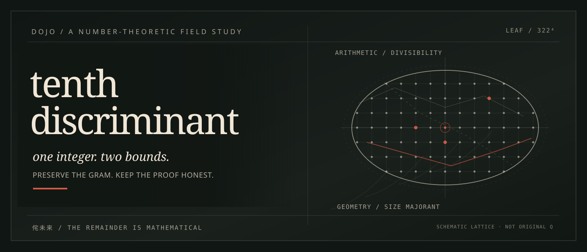
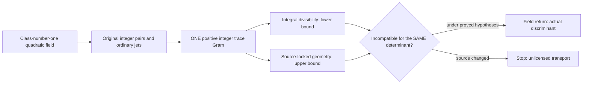

<div align="center">



<sub>侘未来 · WABI-FUTURISM / NUMBER THEORY × INTEGRAL GEOMETRY × FORMAL PROOF</sub>

# tenth / discriminant

### one integer. two bounds.

*Arithmetic wants it large. Geometry wants it small.*

**Preserve the Gram. Keep the proof honest.**

<sub>数と形のあいだに、証明がある。 · Between number and form, there is a proof.</sub>

</div>

---

## 00 / The question that remains

Can arithmetic force an integer determinant to be **larger** than geometry allows?

This repository investigates a version of [Terence Tao's experimental tenth-discriminant challenge](https://terrytao.wordpress.com/2026/10/20/an-experimental-ai-math-challenge-using-tenth-discriminant-bounds-to-explore-arguments-ruling-out-siegel-zeroes/), using original ordinary polynomial jets, an **integer trace Gram**, exact lattice-point geometry and Lean 4.

The hard part is not producing a smaller numerical cutoff. It is proving that the two estimates concern **the same integer**, with the same sampling set, lattice, derivatives, trace weights and number-field assumptions.

> A beautiful argument about the wrong determinant is not an argument about this determinant.

**The active evidence boundary — 20 November 2026:** public *main* still contains the Lean-checked **322⁴ actual-field bound**. Sharper **321⁴** and **307⁴** actual-field theorems remain **research-only**, pending independent source-to-field review. Source-exact **14⁴** complete-ellipse interpolation and original integer-Gram positivity are formally checked on research branches; **302⁴** scalar separation, corrected radius and conditional binary/odd lower are checked in separate research fibers. The **302⁴ original-Gram analytic upper is a draft proof target**, not yet an integrated field theorem. The [dated claim and dependency register](research/CURRENT_EVIDENCE_FRONTIER_20261120.md) names every gate and negative control.

The [full prior technical README](docs/README_MAIN_SNAPSHOT_2026-11-18.md) is archived without rewriting its historical mathematical claims.

## 01 / The public theorem

The merged [Phase200 PR #126](https://github.com/Dojo-1/tenth-discriminant/pull/126) includes a theorem about the **actual absolute field discriminant**, not an auxiliary Gram determinant. Under its Lean-encoded definitions and standard axioms:

```math
|\mathrm{disc}(K)| < 322^4
  = 10{,}750{,}371{,}856
```

for every **totally complex degree-two number field** $K$ of **class number one**.

The theorem is exposed in [ActualField322.lean](lean/TenthDiscriminant/ActualField322.lean). The merged PR reports all **21 associated exact-head checks passed**, including the whole-root Lean library build, source correspondence, permitted-axiom audit and negative controls.

**This is a kernel-checked encoded theorem**, not an independently peer-reviewed proof of every intended correspondence between original mathematical sources and formal definitions. [Independent semantic reconstruction #50](https://github.com/Dojo-1/tenth-discriminant/issues/50) remains open. No new nine-field classification, priority claim, or best-in-class numerical bound is asserted.

## 02 / One determinant, and no substitutes

Fix the original rectangular monomials $Z^rW^s$. Their ordinary derivatives **with $W$ held fixed** are

```math
\partial_Z^j(Z^rW^s)=
\begin{cases}
(r)_{\underline{j}}\,Z^{r-j}W^s,&0\leq j\leq r,\\
0,&j>r.
\end{cases}
```

At the original integer-pair samples $Q$, their real and imaginary coordinate channels form an **integer** evaluation matrix $E_Q$. Retain the original positive trace-channel metric $B_Q$, whose paired channel weights are $2$ and $2D$ in the odd quadratic chart. The common integer is

```math
G_Q=E_Q B_Q E_Q^{\mathsf T},
\qquad
\Delta_Q=\det(G_Q)>0.
```

**Two independent routes must meet at this exact $\Delta_Q$:**

| Route | Mathematical task | Guard against false transport |
| :-- | :-- | :-- |
| **Arithmetic** | Force integer prime-power divisibility of $\Delta_Q$ through guarded inert-prime, binary and integral-jet arguments | An auxiliary minor or changed observation lattice is not the same Gram |
| **Geometry** | Bound that same positive $\Delta_Q$ through ordinary-jet interpolation, original ellipse samples and a Hadamard majorant | An enlarged ellipse is permitted as a *count majorant*, not as a replacement determinant |



The field discriminant and $\Delta_Q$ are different integers. The theorem works only because the **field-return step** transports the resulting contradiction to the right field object.

### The collision in the checked 322⁴ route

For the original source and its encoded dimension/radius guards, the two normalized logarithmic estimates are

```math
\frac{999997}{1000000}\log D
-\frac{57193}{10000}+\frac14\log 2
\ \leq\ \frac{\log\det(G_D)}{R^2S}
\ \leq\ \frac45\log D-\frac{1853}{2000}.
```

At $D\geq322^4$, the certified rational-log floor makes these inequalities incompatible. The explicit conservative positive margin is **2853 / 500000000**.

The [independent-source reconstruction](research/bridges/INDEPENDENT_RECONSTRUCTION_AND_MINORS_20261104.md) specifies the jets, lattice, analytic estimates, arithmetic divisors and field return in more detail. That reconstruction was performed with AI assistance; it is **not** a human-referee report.

## 03 / The ellipse remembers the lattice

The geometry is not a decorative Euclidean sketch. It is a finite source with an **integral coordinate chart**:

```math
Q_{D,\rho}=
\{(x,y)\in\mathbb Z^2\mid x^2+D\,y^2\leq\rho^2\}.
```

Every assertion about the sample count must refer to the **actual $Q_{D,\rho}$ used by the Gram**. Moving frames can be useful, but their transformations have to carry derivative conventions, the integral lattice, the metric and the observation map coherently. A volume-preserving real shear need not preserve the original integral congruence class.

**New on main, 18 November 2026:**

- [Euclid cell-count bridge — PR #226](https://github.com/Dojo-1/tenth-discriminant/pull/226) establishes source-preserving ellipse-count and positive **original integer Gram** results at the geometric condition $D\geq252^4$. Its proof lives in [Euclid252Count.lean](lean/TenthDiscriminant/Euclid252Count.lean). It does **not** supply the arithmetic/logarithmic field contradiction at that threshold.
- [Source-locked moving-frame ordinary jets — PR #227](https://github.com/Dojo-1/tenth-discriminant/pull/227) checks the polynomial chart $U=Z,\ V=W-Z$. Holding $W$ fixed when varying $Z$ requires the path $(U,V)\mapsto(U+T,V-T)$. The result recovers the **original ordinary $Z$-jets**, not a Hasse derivative or a tangent derivative silently substituted for them. See [E14MovingFrameJet.lean](lean/TenthDiscriminant/E14MovingFrameJet.lean).

The artwork above depicts a **schematic** integer lattice and ellipse. It does not draw the actual immense finite set $Q_{D,\rho}$ for the checked theorem.

## 04 / The frontier is not the publication

| Line of inquiry | State | What does **not** follow |
| :-- | :-- | :-- |
| **Phase200 · 322⁴** | **Merged, Lean-checked on its reviewed head** · [PR #126](https://github.com/Dojo-1/tenth-discriminant/pull/126) | Independent human semantic sign-off |
| **Phase267 · 321⁴** | Lean-checked research declaration, consolidated away from main; superseded [PR #157](https://github.com/Dojo-1/tenth-discriminant/pull/157) is closed **without merge** | A new mainline field bound or independently validated proof |
| **Phase346–349 · 307⁴** | Source-preserving actual-field theorem **candidate** · [draft PR #223](https://github.com/Dojo-1/tenth-discriminant/pull/223) | A checked published theorem at 307⁴ |
| **Euclid252** | **Merged** source-ellipse count and positive-Gram geometry · [PR #226](https://github.com/Dojo-1/tenth-discriminant/pull/226) | An actual-field 252⁴ inequality |
| **Moving-frame jets** | **Merged** source-locking identity · [PR #227](https://github.com/Dojo-1/tenth-discriminant/pull/227) | New inert-prime divisibility, unchanged field bound |
| **Cross-method comparison** | Source alignment and finite negative controls · [Issue #51](https://github.com/Dojo-1/tenth-discriminant/issues/51) | Transferring another team's selected complex minor into our entire real trace Gram |

The failure modes matter as much as successful bounds. A **selected nonzero minor modulo a prime** need not make the corresponding **real trace Gram** invertible modulo that prime: see the exact finite [Phase201 counterexample](research/bridges/INDEPENDENT_RECONSTRUCTION_AND_MINORS_20261104.md). It is a counterexample to an *unlicensed inference*, not to the Phase200 theorem or another investigator's independently formulated argument.

A second exact warning: the rational shear below preserves the determinant but not the anchored integral lattice reference.

```math
H=\begin{pmatrix}1&\frac12\\0&1\end{pmatrix},
\quad
G_0=\begin{pmatrix}4&0\\0&4\end{pmatrix},
\quad
HG_0H^{\mathsf T}
=\begin{pmatrix}5&2\\2&4\end{pmatrix}.
```

Both displayed integral Grams have determinant $16$; they are not congruent over the original integral lattice. A matching real volume is weaker than source-matched integer arithmetic. See [TransportCoherence.lean](lean/TenthDiscriminant/TransportCoherence.lean).

## 05 / Reproduce; do not merely admire

The formal project pins **Lean 4.19.0** and Mathlib commit **c44e0c8ee63ca166450922a373c7409c5d26b00b**.

```sh
cd lean
lake exe cache get
python3 verify_sources.py
lake build
python3 audit.py
python3 negative_controls.py
```

For bounded, exact finite controls, return to the repository root:

```sh
python3 -m pip install sympy==1.14.0 mpmath
python3 research/reverse_determinant/phase158_characteristic_jets.py
python3 research/reverse_determinant/phase181_normalized_binary_filtration.py
```

The Markdown/MathJax-sensitive README sanity checks are part of the reader contract:

```sh
python3 scripts/check_readme_math.py README.md
python3 scripts/check_human_math.py
```

**No experimental calculations or Lean builds are implied by this documentation redesign.** Exact-head CI receipts are linked in the research PRs. Executing a checker confirms what its own test contract covers; it does not substitute for human reconstruction of the original number-theoretic argument.

## 06 / Whose mathematics, whose evidence?

**Terence Tao** proposed the challenge and its broader mathematical framing. The derivative-determinant approach is credited to **Ben Green**; related directions from **Roelof van Dijk, Kyle Pratt**, and other participants are distinct. Stronger numerical cutoffs using **different determinant objects or hypotheses** exist in the public discussion: compare the actual assumptions and sources before ranking them. The [prior-art ledger](PRIOR_ART.md), [method comparison](METHOD_COMPARISON_CURRENT.md), and [research state](RESEARCH_NOW.md) preserve those differences.

Research direction: **Jesús Vilela Jato (Dojo-1)**, with substantial AI assistance for conjecture generation, coding, Lean formalization, explanations and checking. The AI systems are **not independent referees**. This project invites reconstruction, adversarial counterexamples and review, rather than taking aesthetic coherence as evidence of a theorem.

The evidence labels distinguish **P** (proof relative to an exact formal statement and permitted axioms), **M** (bounded measurement), **H** (unproved target), **S** (semantic/design proposal), and **R** (retired or unresolved claim). Where the mapping from historical mathematics into formal definitions has not been independently reconstructed, that gap stays explicit.

[Independent human review #50](https://github.com/Dojo-1/tenth-discriminant/issues/50) · [Source/Gram alignment review #51](https://github.com/Dojo-1/tenth-discriminant/issues/51) · [Original technical README snapshot](docs/README_MAIN_SNAPSHOT_2026-11-18.md)

---

<div align="center">

### 間 — ma

*Leave space between an elegant estimate and a theorem about the right object.*

**one integer. two bounds. no borrowed certainty.**

<sub>TENTH / DISCRIMINANT · OBSERVABLES SURVIVE ONLY WHEN THEIR SOURCES DO</sub>

</div>
