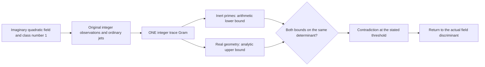

# The Tenth Discriminant

*Arithmetic against geometry, with one integer determinant in the middle.*

Can arithmetic force an integer to be **larger** than geometry allows it to be?

That is the guiding question of this AI-assisted investigation, begun in response to [Terence Tao's experimental tenth-discriminant challenge](https://terrytao.wordpress.com/2026/10/20/an-experimental-ai-math-challenge-using-tenth-discriminant-bounds-to-explore-arguments-ruling-out-siegel-zeroes/). The difficult part is not making a number smaller. It is showing that the arithmetic lower bound and geometric upper bound genuinely constrain **the same integer**, with the same polynomial jets, integral lattice, sampling set and field assumptions.

The repository combines number theory, exact computation, integral linear algebra, real geometry and Lean 4. It also records failed approaches. A failed transport, a lost prime factor or an incorrect normalization is useful evidence—not something to hide behind a more impressive-looking theorem.

## Where the formal work stands

**Current mainline Lean theorem — 2 November 2026.** For every totally complex quadratic number field $K$ of class number one, the encoded and checked theorem concludes that the *actual absolute field discriminant* satisfies

```math
\left|\mathrm{disc}(K)\right|
< 377^4
= 20{,}200{,}652{,}641.
```

This is the claim in [`Threshold377.totallyComplex_degree_two_classNumber_one_discriminant_bound_377`](lean/TenthDiscriminant/ActualField377.lean), merged in [PR #97](https://github.com/Dojo-1/tenth-discriminant/pull/97). See the [exact-head whole-library verification](https://github.com/Dojo-1/tenth-discriminant/actions/runs/41508959650) and the [human proof guide](research/thin_integrated/PHASE178_HUMAN_GUIDE.md).

**The boundary matters.** Lean checks the formal statement relative to its definitions, imports and permitted axioms. Its source correspondence and negative controls were tested, but an independent mathematician has **not** yet reconstructed every classical object and implication in the argument. That separate, important task remains [open in Issue #50](https://github.com/Dojo-1/tenth-discriminant/issues/50). The result is neither a new classification of the nine imaginary quadratic class-number-one fields nor a claim of peer-reviewed novelty.

Earlier checked endpoints—[41,006,250,000](research/thin_integrated/HUMAN_GUIDE_CURRENT.md) and [approximately 47 billion](research/tight_radial_v1/HUMAN_RECONSTRUCTION.md)—remain part of the formal history, not the strongest mainline result. Proposed five-billion and alternative-support arguments are **not** established field bounds.

## The one integer that matters

Take the original rectangular monomials $Z^rW^s$. Their ordinary $Z$-derivatives, **holding $W$ fixed**, are

```math
\partial_Z^j(Z^rW^s)=
\begin{cases}
(r)_{\underline{j}}\,Z^{r-j}W^s, & 0\le j\le r,\\
0, & j>r.
\end{cases}
```

Evaluating these jets at the original integer-pair observations $Q$ produces an integer matrix $E_Q$. The original trace pairing supplies the positive diagonal channel metric $B_Q$, with weights $2$ and $2D$ in the corresponding channels. Together they define

```math
G_Q=E_QB_QE_Q^{\mathsf T},
\qquad
\Delta_Q=\det G_Q>0.
```

The determinant $\Delta_Q$ is an **auxiliary integer**, *not* the number field's discriminant. It is the meeting place of two arguments:

- **Arithmetic:** guarded inert-prime and binary divisibility force $\Delta_Q$ to have sufficient prime factors.
- **Geometry:** the original ordinary-jet Hadamard bound constrains the size of that very same $\Delta_Q$.

Changing $Q$, the derivative convention, the lattice or the trace metric can change the problem. A prettier estimate for a *different* Gram is not a proof about the original one.



## How the 377⁴ argument closes

The [Phase178 guide](research/thin_integrated/PHASE178_HUMAN_GUIDE.md) gives the complete source-to-theorem route. The short version fixes the original thin-ellipse support $Q_D$, the original trace weights and $J=S$, with the original dimensions $R$ and $S$. For $D\ge 377^4$, the formal proof compares the same positive $G_D$ using the scale $R^2S$.

Under the *hypothetical* class-number-one premise, the encoded arithmetic lower and real-place upper together imply

```math
\frac{999997}{1000000}\log D
-\frac{5739}{1000}
+\frac14\log 2
\;\le\;
\frac{\log\det G_D}{R^2S}
\;\le\;
\frac45\log D-\frac{1849}{2000}.
```

The earlier binary factor is counted **once**, alongside the odd-prime contribution. The padded ellipse bounds the **number of observations**; its determinant is never substituted for the thin-Gram determinant. The checked logarithmic guard gives $\log D\ge23.7$ in this regime, and the proposed lower bound then lies strictly above the upper bound. That contradiction rules out the class-number-one premise at the threshold. The existing maximal-order and field-equivalence bridges return from the auxiliary calculation to the actual field statement.

The smallest useful reading path is [Phase178 human guide](research/thin_integrated/PHASE178_HUMAN_GUIDE.md) → [the exact Lean declaration](lean/TenthDiscriminant/ActualField377.lean) → [Issue #50's independent reconstruction obligations](https://github.com/Dojo-1/tenth-discriminant/issues/50).

## What the different investigations establish

| Thread | What survives scrutiny | Where to inspect |
| --- | --- | --- |
| **Arithmetic (Phases162–166)** | Lean-checked divisibility and logarithmic lemmas for the original ordinary-jet Gram, with one binary factor and an odd-only prime product. | [Binary divisor](lean/TenthDiscriminant/BinaryNullTraceGram.lean) · [binary normalization](research/thin_integrated/PHASE165_EXACT_BINARY_NORMALIZATION.md) · [same-Gram log guide](research/thin_integrated/PHASE166_SAME_GRAM_LOG.md) |
| **Actual field bound (Phases169–178)** | Encoded strict $377^4$ field-discriminant endpoint, with exact-head formal/source checks; external semantic review still open. | [Human guide](research/thin_integrated/PHASE178_HUMAN_GUIDE.md) · [PR #97](https://github.com/Dojo-1/tenth-discriminant/pull/97) |
| **Characteristic observations (Phase158)** | Exact finite rank, coefficient-obstruction and $2$-adic capacity experiments; no uniform new field cutoff. | [Dossier](research/reverse_determinant/PHASE158_CHARACTERISTIC_JETS.md) · [verifier](research/reverse_determinant/phase158_characteristic_jets.py) |
| **Support and arithmetic gluing (Phases142, 159–160)** | Exact finite examples separating full rank, integral image, Smith data and Gram volume. A smaller support need not yield a smaller determinant bound. | [Phase142](research/ellipsoid_trimming/PHASE142_LEVERAGE_AND_UNISOLVENCE.md) · [Phase159](research/reverse_determinant/PHASE159_OBSERVATION_CONTINUUM.md) · [Phase160](research/reverse_determinant/PHASE160_ARITHMETIC_NEURITES.md) |
| **Symmetry (Phase161)** | Source-preserving conjugation and related finite controls; removing a symmetric observation is not automatically safe. | [Human guide](research/reverse_determinant/PHASE161_SYMMETRY_GUIDE.md) · [Lean](lean/TenthDiscriminant/ObservationConjugation.lean) |
| **Transport coherence (Phase179)** | A rational determinant-one shear can preserve volume while failing to preserve an *anchored* integral lattice. The new Lean non-congruence statement is under draft-PR CI review, **not promoted to main**. | [Draft PR #98](https://github.com/Dojo-1/tenth-discriminant/pull/98) |

One exact arithmetic example behind the current transport study is worth keeping in sight:

```math
H=\begin{pmatrix}1&\frac12\\0&1\end{pmatrix},
\qquad
G_0=\begin{pmatrix}4&0\\0&4\end{pmatrix},
\qquad
HG_0H^{\mathsf T}
=\begin{pmatrix}5&2\\2&4\end{pmatrix}.
```

The two integral Grams have equal determinant $16$, yet not the same integral congruence class. The obstruction is concentrated at the prime $2$ *relative to the fixed lattice reference*. Transport the reference lattice as well, and the semantic question changes. This counterexample is not a new discriminant bound and not a theorem of intrinsic computational hardness. The ongoing formalization is in [PR #98](https://github.com/Dojo-1/tenth-discriminant/pull/98).

For the dated, detailed research record—including unsuccessful attempts—see [RESEARCH_NOW.md](RESEARCH_NOW.md), the [reverse-determinant research index](research/reverse_determinant/README.md), and the [prior-art ledger](PRIOR_ART.md). The [earlier long README is archived](research/archive/ROOT_README_BEFORE_PHASE158_2026-11-01.md).

## Reproduce, inspect, challenge

The repository pins **Lean 4.19.0** and **Mathlib `c44e0c8ee63ca166450922a373c7409c5d26b00b`**. To build and audit the formal library:

```sh
cd lean
lake exe cache get
python3 verify_sources.py
lake build
python3 audit.py
python3 negative_controls.py
```

For one bounded exact finite experiment, from the repository root:

```sh
python3 -m pip install sympy==1.14.0 mpmath
python3 research/reverse_determinant/phase158_characteristic_jets.py
```

For the documentation's math/Markdown sanity check:

```sh
python3 scripts/check_readme_math.py README.md
```

A successful finite test is evidence about the tested instances. A successful Lean build is evidence about the *encoded theorem*. Neither is an independent external review of the whole intended argument. If you find a missing hypothesis, wrong field identification, false lemma, normalization mismatch or counterexample, please include the exact claim and a reproducible witness. [Issue #50](https://github.com/Dojo-1/tenth-discriminant/issues/50) and [the source-to-source transport review](https://github.com/Dojo-1/tenth-discriminant/issues/51) are natural starting points.

## Attribution and context

The challenge and its [adelic-determinant context](https://terrytao.wordpress.com/2026/10/19/a-sketch-of-the-proof-of-non-existence-of-siegel-zeroes/) are due to **Terence Tao**. The derivative-determinant approach is credited to **Ben Green**; **Roelof van Dijk** and **Kyle Pratt** contributed distinct related methods discussed in Tao's thread. Related arguments and formalizations by **twinheterodox, Peter Murphy, Antoine Olivier**, and others include stronger bounds. The citations neither imply collaboration nor endorsement; see [PRIOR_ART.md](PRIOR_ART.md) and [METHOD_COMPARISON_CURRENT.md](METHOD_COMPARISON_CURRENT.md).

The question behind our characteristic-support experiments was inspired by **Miguel N. Walsh's** work on the polynomial method, not presented as a theorem he proved about our construction. See [Walsh's ICM survey](https://www.mathunion.org/fileadmin/ICM/Proceedings/uploads/ICM-2018-vol2-ver1-eb.pdf), [the inverse sieve problem](https://doi.org/10.1215/00127094-1645788), and [the polynomial method over varieties](https://doi.org/10.1007/s00222-020-00975-6).

Research direction: **Jesús Vilela Jato (Dojo-1)**, with substantial AI assistance for exploration, code, Lean, explanatory writing and checking. The AI systems are not independent referees. Our aim is not to turn machine-generated polish into borrowed authority, but to leave every mathematical claim open to reconstruction and correction.

*Documentation convention:* use inline $x$-style math and fenced `math` blocks for displayed formulae. Do not place mathematical expressions inside code spans or split a single-dollar expression across multiple lines. The sanity checker catches common markup failures, **not** mathematical mistakes or every possible MathJax rendering defect.
