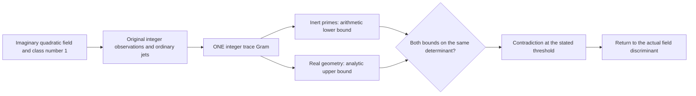

# The Tenth Discriminant

> **Current checked public endpoint — 4 November 2026.** The merged [Phase200 PR #126](https://github.com/Dojo-1/tenth-discriminant/pull/126) contains the actual-field, class-number-one theorem `|disc(K)| < 322^4 = 10,750,371,856`, relative to its encoded Lean definitions and standard axioms; independent human semantic review remains open in [#50](https://github.com/Dojo-1/tenth-discriminant/issues/50). [Phase209 draft #157](https://github.com/Dojo-1/tenth-discriminant/pull/157) explores an optimal ordinary-jet p-adic depth mechanism and a **conditional** `321^4` target; it is **not** a new field theorem. In Tao's Math 2.0 framing, we also compare zero-exclusion methods and what humans can reconstruct: [scope #158](https://github.com/Dojo-1/tenth-discriminant/issues/158). The 328^4 and 327^4 status prose retained below is a **dated historical snapshot**, not the current endpoint.

*Arithmetic against geometry, with one integer determinant in the middle.*

Can arithmetic force an integer to be **larger** than geometry allows it to be?

That is the guiding question of this AI-assisted investigation, begun in response to [Terence Tao's experimental tenth-discriminant challenge](https://terrytao.wordpress.com/2026/10/20/an-experimental-ai-math-challenge-using-tenth-discriminant-bounds-to-explore-arguments-ruling-out-siegel-zeroes/). The difficult part is not making a number smaller. It is showing that the arithmetic lower bound and geometric upper bound genuinely constrain **the same integer**, with the same polynomial jets, integral lattice, sampling set and field assumptions.

The repository combines number theory, exact computation, integral linear algebra, real geometry and Lean 4. It also records failed approaches. A failed transport, a lost prime factor or an incorrect normalization is useful evidence—not something to hide behind a more impressive-looking theorem.

## Where the formal work stands

**Current mainline Lean theorem — 4 November 2026.** For every totally complex degree-two number field \(K\) of class number one, the integrated theorem bounds the **actual absolute field discriminant**:

\[
|\mathrm{disc}(K)|<322^4=10{,}750{,}371{,}856.
\]

[PR #126](https://github.com/Dojo-1/tenth-discriminant/pull/126) integrated [Threshold322.totallyComplex_degree_two_classNumber_one_discriminant_bound_322](lean/TenthDiscriminant/ActualField322.lean) at [merge f41ce45b](https://github.com/Dojo-1/tenth-discriminant/commit/f41ce45b9dd7d722faa682d3f1dc1c204fb571da); all 21 associated workflows passed on its reviewed head, including full-root Lean build, source-coverage check, standard-axiom audit and negative controls. Historical integrated 323⁴, 324⁴, 327⁴, 328⁴ and 331⁴ results remain auditable.

**Independent semantics remains an open question, not a CI gate.** [Issue #50](https://github.com/Dojo-1/tenth-discriminant/issues/50) requests human reconstruction and challenge of the source definitions, maximal-order/inert-prime reduction, arithmetic divisor, original ellipse interpolation, Hadamard majorant and field transport. [Phase201 source-based reconstruction and exact finite cross-construction counterexample](research/bridges/INDEPENDENT_RECONSTRUCTION_AND_MINORS_20261104.md) explicitly distinguish AI reconstruction from independent human peer review. No claim of priority, numerical competitiveness or a new nine-field classification follows from the 322⁴ theorem.

**Other constructions are not substitutes for ours.** [twinheterodox v0.7.0](https://github.com/twinheterodox/tenth-discriminant/tree/v0.7.0/versions/v7) reports the much stronger cutoff \(q<570\), selecting a nonzero derivative-matrix complex minor with an auxiliary inert-prime rank argument. Our proof bounds the entire original real integer trace Gram. The finite Phase201 test shows that a nonzero complex derivative minor modulo a prime need not make the corresponding real trace-Gram determinant nonzero modulo that prime. See the typed [cross-program alignment](research/bridges/EXTERNAL_DETERMINANT_ALIGNMENT_20261103.md) and [Issue #51](https://github.com/Dojo-1/tenth-discriminant/issues/51). No other investigator was contacted and no external theorem was imported.

## The one integer that matters

Take the original rectangular monomials $Z^rW^s$. Their ordinary $Z$-derivatives, **holding $W$ fixed**, are

```math
\partial_Z^j(Z^rW^s)=
\begin{cases}
(r)_{\underline{j}}\,Z^{r-j}W^s, & 0\le j\le r,\\
0, & j>r.
\end{cases}
```

Evaluating these jets at the original integer-pair observations $Q$ produces an integer matrix $E_Q$. The original trace pairing supplies the positive diagonal channel metric $B_Q$, with weights $2$ and $2D$ in the corresponding channels. Together they define

```math
G_Q=E_QB_QE_Q^{\mathsf T},
\qquad
\Delta_Q=\det G_Q>0.
```

The determinant $\Delta_Q$ is an **auxiliary integer**, *not* the number field's discriminant. It is the meeting place of two arguments:

- **Arithmetic:** guarded inert-prime and binary divisibility force $\Delta_Q$ to have sufficient prime factors.
- **Geometry:** the original ordinary-jet Hadamard bound constrains the size of that very same $\Delta_Q$.

Changing $Q$, the derivative convention, the lattice or the trace metric can change the problem. A prettier estimate for a *different* Gram is not a proof about the original one.



## How the integrated 322⁴ argument closes

Under the class-number-one, squarefree odd-chart hypotheses, set \(R=\lfloor D/4\rfloor\), \(S=\lfloor R/25\rfloor\), and use the original thin integer lattice ellipse of radius \(\lceil 11D^{3/4}/25\rceil\). The original ordinary-\(Z\)-derivative trace Gram \(G_D\) is positive by the [322 source geometry](lean/TenthDiscriminant/SourceGeometry322.lean) and [positivity proof](lean/TenthDiscriminant/SourcePositivity322.lean). Its [same-Gram arithmetic lower](lean/TenthDiscriminant/SameGramLower322.lean) includes original odd primes 3 and 5 and the binary divisor exactly once. The [same-Gram analytic upper](lean/TenthDiscriminant/ThinUpper322.lean) uses the padded ellipse **only as a count majorant**.

For \(D\ge322^4\), the compiled inequalities constrain precisely the **same positive integer determinant**:

\[
\frac{999997}{1000000}\log D-\frac{57193}{10000}+\frac14\log2
\;\le\;\frac{\log\det G_D}{R^2S}
\;\le\;\frac45\log D-\frac{1853}{2000}.
\]

The sound rational logarithm floor gives a certified positive margin of \(2853/500000000\). The [field-return module](lean/TenthDiscriminant/ActualField322.lean) carries the contradiction through both quadratic charts and arbitrary totally complex degree-two fields to the **actual discriminant**, not to \(\det G_D\). The exact calculation and unresolved semantic obligations are recorded in [Phase201](research/bridges/INDEPENDENT_RECONSTRUCTION_AND_MINORS_20261104.md).

## What the different investigations establish

| Thread | What survives scrutiny | Where to inspect |
| --- | --- | --- |
| **Arithmetic (Phases162–166)** | Lean-checked divisibility and logarithmic lemmas for the original ordinary-jet Gram, with one binary factor and an odd-only prime product. | [Binary divisor](lean/TenthDiscriminant/BinaryNullTraceGram.lean) · [binary normalization](research/thin_integrated/PHASE165_EXACT_BINARY_NORMALIZATION.md) · [same-Gram log guide](research/thin_integrated/PHASE166_SAME_GRAM_LOG.md) |
| **Actual field bound (Phase200)** | Encoded strict $322^4$ actual-field endpoint, full-root Lean-checked and merged in PR #126; external semantic review remains open. | [322 source](lean/TenthDiscriminant/ActualField322.lean) · [PR #126](https://github.com/Dojo-1/tenth-discriminant/pull/126) |
| **Original prime recovery (Phase200B)** | The $0.0901$ normalized recovery from the *original primes 3 and 5* is integrated into the $322^4$ source lower with explicit size and floor hypotheses. | [Verified gain](lean/TenthDiscriminant/Phase200PrimeRecovery322.lean) · [source lower](lean/TenthDiscriminant/SourceOddBinary322.lean) |
| **Historical 323–327 fourth-root endpoints** | Earlier checked thresholds superseded numerically by the merged 322⁴ endpoint; preserved as historical proof paths, not today's frontier. | [323 source](lean/TenthDiscriminant/ActualField323.lean) · [327 source](lean/TenthDiscriminant/ActualField327.lean) |
| **Characteristic observations (Phase158)** | Exact finite rank, coefficient-obstruction and $2$-adic capacity experiments; no uniform new field cutoff. | [Dossier](research/reverse_determinant/PHASE158_CHARACTERISTIC_JETS.md) · [verifier](research/reverse_determinant/phase158_characteristic_jets.py) |
| **Support and arithmetic gluing (Phases142, 159–160)** | Exact finite examples separating full rank, integral image, Smith data and Gram volume. A smaller support need not yield a smaller determinant bound. | [Phase142](research/ellipsoid_trimming/PHASE142_LEVERAGE_AND_UNISOLVENCE.md) · [Phase159](research/reverse_determinant/PHASE159_OBSERVATION_CONTINUUM.md) · [Phase160](research/reverse_determinant/PHASE160_ARITHMETIC_NEURITES.md) |
| **Symmetry (Phase161)** | Source-preserving conjugation and related finite controls; removing a symmetric observation is not automatically safe. | [Human guide](research/reverse_determinant/PHASE161_SYMMETRY_GUIDE.md) · [Lean](lean/TenthDiscriminant/ObservationConjugation.lean) |
| **Normalized 2-adic filtration (Phase181; bounded pilot)** | After the existing Phase162 row factors are removed, exact Smith barcodes distinguish two D=163 supports having the same first mod-2 nullity. No production-uniform gain or new field cutoff is proved. | [Finite pilot and explanation](research/reverse_determinant/PHASE181_NORMALIZED_BINARY_FILTRATION.md) · [open target #99](https://github.com/Dojo-1/tenth-discriminant/issues/99) |
| **Transport coherence (Phase179)** | The formal determinant-one rational shear preserves volume but not the anchored integral lattice. | [merged PR #98](https://github.com/Dojo-1/tenth-discriminant/pull/98) · [Lean](lean/TenthDiscriminant/TransportCoherence.lean) |

One exact arithmetic example behind the current transport study is worth keeping in sight:

```math
H=\begin{pmatrix}1&\frac12\\0&1\end{pmatrix},
\qquad
G_0=\begin{pmatrix}4&0\\0&4\end{pmatrix},
\qquad
HG_0H^{\mathsf T}
=\begin{pmatrix}5&2\\2&4\end{pmatrix}.
```

The two integral Grams have equal determinant $16$, yet not the same integral congruence class. The obstruction is concentrated at the prime $2$ *relative to the fixed lattice reference*. Transport the reference lattice as well, and the semantic question changes. This counterexample is not a new discriminant bound and not a theorem of intrinsic computational hardness. The formalization is integrated in [PR #98](https://github.com/Dojo-1/tenth-discriminant/pull/98); [PR #104](https://github.com/Dojo-1/tenth-discriminant/pull/104) adds finite fixed-versus-moving extraction controls.

For the dated, detailed research record—including unsuccessful attempts—see [RESEARCH_NOW.md](RESEARCH_NOW.md), the [reverse-determinant research index](research/reverse_determinant/README.md), and the [prior-art ledger](PRIOR_ART.md). The [earlier long README is archived](research/archive/ROOT_README_BEFORE_PHASE158_2026-11-01.md).

## Reproduce, inspect, challenge

The repository pins **Lean 4.19.0** and **Mathlib `c44e0c8ee63ca166450922a373c7409c5d26b00b`**. To build and audit the formal library:

```sh
cd lean
lake exe cache get
python3 verify_sources.py
lake build
python3 audit.py
python3 negative_controls.py
```

For one bounded exact finite experiment, from the repository root:

```sh
python3 -m pip install sympy==1.14.0 mpmath
python3 research/reverse_determinant/phase158_characteristic_jets.py
python3 research/reverse_determinant/phase181_normalized_binary_filtration.py
python3 research/reverse_determinant/phase181_thin_support_pilot.py
```

For the documentation's math/Markdown sanity check:

```sh
python3 scripts/check_readme_math.py README.md
python3 scripts/check_human_math.py
```

A successful finite test is evidence about the tested instances. A successful Lean build is evidence about the *encoded theorem*. Neither is an independent external review of the whole intended argument. If you find a missing hypothesis, wrong field identification, false lemma, normalization mismatch or counterexample, please include the exact claim and a reproducible witness. [Issue #50](https://github.com/Dojo-1/tenth-discriminant/issues/50) and [the source-to-source transport review](https://github.com/Dojo-1/tenth-discriminant/issues/51) are natural starting points.

## Attribution and context

The challenge and its [adelic-determinant context](https://terrytao.wordpress.com/2026/10/19/a-sketch-of-the-proof-of-non-existence-of-siegel-zeroes/) are due to **Terence Tao**. The derivative-determinant approach is credited to **Ben Green**; **Roelof van Dijk** and **Kyle Pratt** contributed distinct related methods discussed in Tao's thread. Related arguments and formalizations by **twinheterodox, Peter Murphy, Antoine Olivier**, and others include stronger bounds. The citations neither imply collaboration nor endorsement; see [PRIOR_ART.md](PRIOR_ART.md) and [METHOD_COMPARISON_CURRENT.md](METHOD_COMPARISON_CURRENT.md).

The question behind our characteristic-support experiments was inspired by **Miguel N. Walsh's** work on the polynomial method, not presented as a theorem he proved about our construction. See [Walsh's ICM survey](https://www.mathunion.org/fileadmin/ICM/Proceedings/uploads/ICM-2018-vol2-ver1-eb.pdf), [the inverse sieve problem](https://doi.org/10.1215/00127094-1645788), and [the polynomial method over varieties](https://doi.org/10.1007/s00222-020-00975-6).

Research direction: **Jesús Vilela Jato (Dojo-1)**, with substantial AI assistance for exploration, code, Lean, explanatory writing and checking. The AI systems are not independent referees. Our aim is not to turn machine-generated polish into borrowed authority, but to leave every mathematical claim open to reconstruction and correction.

*Documentation convention:* use inline $x$-style math and fenced `math` blocks for displayed formulae. Do not place mathematical expressions inside code spans or split a single-dollar expression across multiple lines. The sanity checks catch common markup failures, **not** mathematical mistakes or every possible MathJax rendering defect.
