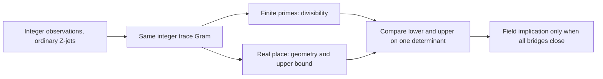

# The Tenth Discriminant

*An AI-assisted investigation of arithmetic, polynomial jets and the geometry of imaginary quadratic fields.*

The question is whether the arithmetic of a number field can force an integer determinant to be **larger** than geometry permits. To be useful, both inequalities must concern **the same integer**, with the same observation points, derivative convention and field hypotheses. This repository explores that requirement through elementary number theory, finite fields, integral linear algebra, convex geometry and Lean.

It began in response to [Terence Tao's experimental tenth-discriminant challenge](https://terrytao.wordpress.com/2026/10/20/an-experimental-ai-math-challenge-using-tenth-discriminant-bounds-to-explore-arguments-ruling-out-siegel-zeroes/). The objective is not simply the smallest decimal cutoff: a proof that can be reconstructed and challenged by another mathematician matters at least as much.

## The verified result and its boundary

The mainline [Lean theorem](lean/TenthDiscriminant/TightRadialEndpoint.lean) establishes the strict implication

$$
h(K)=1,\quad [K:\mathbf Q]=2,\quad K\text{ imaginary quadratic}
\quad\Longrightarrow\quad
|\operatorname{disc}(K)|<47{,}000{,}000{,}000.
$$

This is the **actual field discriminant**, not the determinant of our polynomial Gram. The checked statement is not a classification of the nine fields and is not competitive with the strongest bounds reported by other challenge participants. Its mathematical interpretation and the surrounding arguments still invite [independent human reconstruction](https://github.com/Dojo-1/tenth-discriminant/issues/50).

Our newer **5-billion** computations are **research candidates**, not a stronger Lean theorem or an independently established field bound. The full arithmetic–analytic bridge is unfinished. [Read the proof in human order](research/tight_radial_v1/HUMAN_RECONSTRUCTION.md) or inspect the [evidence ledger](RESEARCH_NOW.md).

## What the determinant remembers

The original observable is the ordinary directional jet

$$
\partial_Z^j(Z^rW^s)=(r)_{\underline j}Z^{r-j}W^s,
\qquad W\text{ held fixed}.
$$

For a finite set `Q` of integer-pair observations, these form an integer matrix `E_Q`. Its positive trace metric `B_Q` has diagonal weights `2,2D`, and we compare the same positive integer

$$
G_Q=E_QB_QE_Q^{\mathsf T},\qquad d_Q=\det G_Q>0
$$

from two directions. **Inert primes** force divisibility of `d_Q`; **the real geometry** of the observation ellipse constrains its size. A jet-normalization or change of sampling set is not free: any arithmetic, rank or metric remainder must be transported explicitly.



## A smaller set that still sees the same polynomial

The most recent experiment asks a question inspired by **Miguel N. Walsh's characteristic-subset viewpoint**: which observations are actually needed to force the original polynomial to vanish?

For an odd inert witness prime `p`, set `R=p-1` and `S=J≤R`. On the Frobenius graph `W=Z^p`, the original rectangular monomials restrict to `T^{r+ps}`. Their degree is at most `pS-2`. **Exactly `p` distinct conjugate-closed roots are sufficient** for full row rank of the original ordinary-jet matrix: a nonzero polynomial cannot vanish to order `S` at all those roots.

Using **`p-1` roots** is subtler. Rank becomes equivalent to the invertibility of a much smaller `(S-1)×(S-1)` coefficient obstruction. We preserve a concrete counterexample where that matrix is singular. The formula and numerical controls belong to our [Phase158 dossier](research/reverse_determinant/PHASE158_CHARACTERISTIC_JETS.md); they are not Walsh's theorems, nor has this algebraic step been formalized in Lean.

For the illustrative `D=163,p=31,R=30,S=5` case, a characteristic selection uses **26 integer nodes / 31 effective roots**, retains full rank 150 in independent finite-field representations, and raises the guaranteed 2-adic jet-capacity floor from 310 to 430 while reducing the raw diagonal Hadamard upper. These are **finite exact results**, not proof of the all-`D` cutoff.

[Phase158 — readable mathematical dossier](research/reverse_determinant/PHASE158_CHARACTERISTIC_JETS.md) · [Exact verifier](research/reverse_determinant/phase158_characteristic_jets.py) · [Full Phases144–158 research index](research/reverse_determinant/README.md)

## Observation continua: a correction from Phase159

[Phase159](research/reverse_determinant/PHASE159_OBSERVATION_CONTINUUM.md) connects the original ordinary-jet Grams over different observation supports through continuous real weights while keeping the lattice and prime-adic data exact. In the D=163, p=31, S=5 finite control, all 21 real-root deletions from the 31-root support retain full rank, with certified 2-adic factorial capacity 450 instead of 430. But small p=7 and p=11 counterexamples show deletion is **not** universally safe. Exact 2-adic Smith computations further show that the *actual* valuation can rise or fall under deletion, even as the real determinant decreases. Both [obstruction tests](research/reverse_determinant/phase159_observation_continuum.py) and [2-adic tests](research/reverse_determinant/phase159_padic_gram.py) are finite; neither proves the proposed 5-billion field cutoff or adds a Lean theorem. See the [evidence ledger](RESEARCH_NOW.md).

## Reconstruct the evidence

The project pins **Lean 4.19.0** and **Mathlib `c44e0c8ee63ca166450922a373c7409c5d26b00b`**. For the finite characteristic-set experiment, from repository root:

```sh
python3 -m pip install sympy==1.14.0 mpmath
python3 research/reverse_determinant/phase158_characteristic_jets.py
```

For the formal library:

```sh
cd lean
lake exe cache get
python3 verify_sources.py
lake build
python3 audit.py
python3 negative_controls.py
```

Exact-head checks are in [finite workflow](.github/workflows/reverse-determinant-finite.yml) and [Lean workflow](.github/workflows/lean.yml). A green finite test certifies its tested matrices, not a universal number-field argument; a clean Lean build checks encoded statements, not their semantic correspondence with a historical claim. [Independent review](https://github.com/Dojo-1/tenth-discriminant/issues/50) and [cross-method transport](https://github.com/Dojo-1/tenth-discriminant/issues/51) remain open.

## Sources, attribution, and intellectual boundaries

This is cumulative mathematics. **Terence Tao** posed the [challenge](https://terrytao.wordpress.com/2026/10/20/an-experimental-ai-math-challenge-using-tenth-discriminant-bounds-to-explore-arguments-ruling-out-siegel-zeroes/) and developed the surrounding [adelic determinant perspective](https://terrytao.wordpress.com/2026/10/19/a-sketch-of-the-proof-of-non-existence-of-siegel-zeroes/). The derivative-determinant approach is credited to **Ben Green**; **Roelof van Dijk's** finite-field nonvanishing method and **Kyle Pratt's** disk-interpolation suggestion are distinct antecedents discussed in Tao's thread. **twinheterodox, Peter Murphy, Antoine Olivier**, and other contributors have obtained or formalized related arguments, often with substantially stronger cutoffs. See our [dated prior-art ledger](PRIOR_ART.md) and [source-aware comparison](METHOD_COMPARISON_CURRENT.md). These citations do not imply collaboration or endorsement.

**Miguel N. Walsh** deserves specific credit for the *question* behind the new characteristic-support experiment, not for proofs he has not asserted about this construction:

- [*Characteristic subsets and the polynomial method*](https://www.mathunion.org/fileadmin/ICM/Proceedings/uploads/ICM-2018-vol2-ver1-eb.pdf), Proceedings of ICM 2018, vol. II, pp. 485–504 — characteristic subsets and polynomial vanishing.
- [*The inverse sieve problem in high dimensions*](https://doi.org/10.1215/00127094-1645788), *Duke Mathematical Journal* **161** (2012), 2001–2022 — modular sparsity and algebraic structure.
- [*The polynomial method over varieties*](https://doi.org/10.1007/s00222-020-00975-6), *Inventiones mathematicae* **222** (2020), 469–512 — polynomial geometry adapted to varieties.

The specific root-counting, Hermite interpolation, coefficient obstruction, Cauchy–Binet and factorial divisibility steps use **classical mathematics**. Our application and the experiments were developed under **Jesús Vilela Jato's (Dojo-1) research direction**, with substantial assistance from AI systems for exploration, source drafting, code, Lean and critical checking. Those systems are not independent referees. No claim of priority, validation by cited mathematicians or new published theorem is made here.

The longer earlier README is [preserved verbatim in the research archive](research/archive/ROOT_README_BEFORE_PHASE158_2026-11-01.md), rather than continuing as an unmaintainable running log. Mathematical corrections are welcome as an exact failed lemma, counterexample, mismatched normalization or reproducible test—not as an appeal to confidence.
