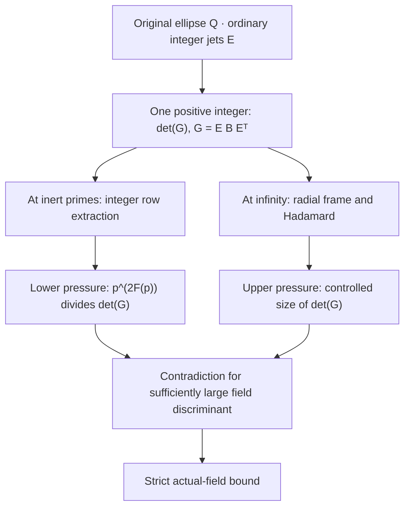

# The Tenth Discriminant

An AI-assisted mathematical investigation of **effective discriminant bounds for imaginary quadratic fields of class number one**, in the spirit of [Terence Tao's experimental tenth-discriminant challenge](https://terrytao.wordpress.com/2026/10/20/an-experimental-ai-math-challenge-using-tenth-discriminant-bounds-to-explore-arguments-ruling-out-siegel-zeroes/).

The guiding question is simple to state: *can arithmetic force an integer determinant to be so divisible that geometry cannot allow it to be that small?* The difficult part is proving that both estimates act on **the same integer**, with the actual field discriminant recovered at the end.

**Verified endpoint.** The [Lean theorem](lean/TenthDiscriminant/TightRadialEndpoint.lean) states that, for every totally complex number field `K` of degree two and class number one,

$$
\bigl|\operatorname{disc}(K)\bigr| < 47\,000\,000\,000.
$$

This is a strict bound on the **actual field discriminant**. It is not the Gram determinant below, a nine-field classification proof, an optimal bound, or a proof about Siegel zeroes. Stronger numerical estimates have been reported by other challenge participants. [Independent semantic review remains open](https://github.com/Dojo-1/tenth-discriminant/issues/50), despite the formal verification.

[Read the human reconstruction](research/tight_radial_v1/HUMAN_RECONSTRUCTION.md) · [Current evidence ledger](RESEARCH_NOW.md) · [Tao objectives and limitations](TAO_OBJECTIVES_CURRENT.md)

**Exploratory finite research, now on the same `main` reading route:** [Reverse determinant · Phases144–151](research/reverse_determinant/README.md) separates integral-image supports, Smith/prime-local obstructions, moving frames and metric upper bounds. Its exact finite certificates do **not** upgrade the theorem above. [PR #61](https://github.com/Dojo-1/tenth-discriminant/pull/61) and [PR #62](https://github.com/Dojo-1/tenth-discriminant/pull/62) remain draft proof work, not silently merged or independently endorsed.


## One integer, seen from several directions

Let `Q` be the **original complete integer ellipse**, and form `E` from the integer coordinates of ordinary polynomial jets of `Z^r W^s` at each original sample (`W` is held fixed while differentiating). With the original positive trace metric `B`, set

$$
G=E B E^{\mathsf T},\qquad \det G>0
$$

under the checked interpolation/point-count guard. **Neither `E` nor its sample set is silently replaced in the comparison.**



For each eligible inert prime `p`, the exact integral identity is

$$
U_p E=\Delta_p C_p,\qquad
\det U_p=1,\qquad
\Delta_p=\operatorname{diag}(p^{k_i}).
$$

The same metric produces the **two-sided** Gram identity

$$
U_p G U_p^{\mathsf T}
=\Delta_p(C_p B C_p^{\mathsf T})\Delta_p,
\quad
p^{2F(p)}\mid\det G,\quad F(p)=\sum_i k_i.
$$

Over the real numbers, an integral radial change of row frame preserves `\det G` while sharpening its Hadamard upper bound. In the production regime, a checked rational logarithm certificate makes the arithmetic lower bound exceed that upper bound for discriminants at or above 47 billion. The number-field chart and equivalence arguments then return to the actual discriminant, including the index-two maximal-order case.

The human proof, not this diagram, carries the hypotheses: [arithmetic bridge](research/ender_radius_bridge/TWO_SIDED_ARITHMETIC_BRIDGE.md), [geometric saving](lean/TenthDiscriminant/TightRadialSaving.lean), [finite logarithm certificate](lean/TenthDiscriminant/TightRadialEndpoint.lean), and [four obligations for an external reader](research/tight_radial_v1/INDEPENDENT_REVIEW_ENTRY.md).

## What was established, and what wasn't

| Result | Evidence and boundary |
| --- | --- |
| **Strict 47-billion actual-field bound** | [Phase133 Lean proof and receipts](research/tight_radial_v1/PHASE133_VERIFICATION.md), [PR #49](https://github.com/Dojo-1/tenth-discriminant/pull/49). The encoded theorem and its checked dependencies, **not** external human endorsement. |
| **All original maximal minors inherit a prime factor** | [Phase134 Lean](lean/TenthDiscriminant/RankDivisorCompatibility.lean), [PR #52](https://github.com/Dojo-1/tenth-discriminant/pull/52). Positive extraction weight makes the *unnormalized* `E` rank-deficient mod `p`; the normalized quotient can regain rank. |
| **Full-ellipse collision and ordinary/Hasse distinction** | [Phase135 Lean](lean/TenthDiscriminant/EllipseResidueTransport.lean), [PR #53](https://github.com/Dojo-1/tenth-discriminant/pull/53). For `0<p≤2ρ`, original ellipse nodes collide modulo `p`. This does not refute a method with a different node set. |
| **Matched original-jet pilot** | [Exact integer Rust instrument](research/rank_divisor_interface/phase135_ordinary_jet_pilot.rs), [passed CI](https://github.com/Dojo-1/tenth-discriminant/actions/runs/41138437024). For `D=19, ρ=5, R=4, S=J=2, p=3`: rank of `E` mod 3 is 7, rank of the integral quotient is 8, and the residual Gram determinant is 2 mod 3. **Finite measurement only.** |
| **Sharp residue threshold and exact selected-minor exponent** | [Phase136 Lean](lean/TenthDiscriminant/Phase136MinorSaturation.lean), [PR #54](https://github.com/Dojo-1/tenth-discriminant/pull/54), [whole-root CI](https://github.com/Dojo-1/tenth-discriminant/actions/runs/41143112832). The *full* ellipse has pairwise distinct coordinate residues iff `p>2ρ`. Under a specified integral normalization and a selected normalized minor not divisible by nonzero `p`, the original minor has exactly the extracted `p`-power, not another. |

A related [local Smith/covolume observation](research/tao_goal_alignment/WORDPRESS_LOCAL_SMITH_COVOLUME_20261030.md) has a short **paper-level argument**, not a separately checked Lean isomorphism: if the normalized quotient has full row rank modulo a prime, its extraction weights determine the `p`-local cokernel invariants of the original observation map. This does **not** force its residual trace Gram to be invertible modulo `p`. Ordinary derivatives versus Hasse/Taylor coefficients, and row normalization versus column rescaling, remain genuine transport obligations.

This distinction matters when comparing our trace-Gram method with the [external exact-rank arguments](METHOD_COMPARISON_CURRENT.md): a selected maximal minor cannot simply replace the upper bound on the **whole** Gram, and a changed observation matrix requires both sides of the determinant argument to be rebuilt. The [WordPress reading notes](research/tao_goal_alignment/WORDPRESS_LOCAL_SMITH_COVOLUME_20261030.md) attribute the motivating ideas to Tao and other contributors instead of claiming that older Smith and exterior-power mathematics was invented here.

## Two open mathematical obligations

**[#50 · Independent reconstruction](https://github.com/Dojo-1/tenth-discriminant/issues/50).** A mathematician outside this AI-assisted authoring loop should check the original field and order, inert-prime/ordinary-jet quotient, same-matrix radial bounds, rational contradiction, and final actual-discriminant transport. [Here is a small reviewer entry point](research/tight_radial_v1/INDEPENDENT_REVIEW_ENTRY.md). Another model's agreement, or a clean CI run, does not close this issue.

**[#51 · Same-observation transport](https://github.com/Dojo-1/tenth-discriminant/issues/51).** The local rank and valuation lemmas are checked; a *global* match to competing normalized-row/column methods, including prime existence, factorial guards, original support and metric nondegeneracy, remains open. [One-matrix two-prime guide](research/rank_divisor_interface/ONE_MATRIX_TWO_PRIMES.md) · [Finite falsification instrument](research/rank_divisor_interface/PHASE135_MATCHED_JETS.md).

## A new bounded question, not a new bound

**Phase137 [M/H].** [An integral Chebyshev-like radial moving frame](research/radial_chebyshev/PHASE137_PROTOCOL.md) replaces centered powers with monic integer recurrences. Its unitriangular row change preserves the **same original determinant and inert-prime divisors**, while potentially lowering Hadamard's diagonal product. In the [exact 32-row ordinary-jet Rust pilot](research/radial_chebyshev/phase137_chebyshev_frame.rs), 12 rows improve and 20 are unchanged, with a checked diagonal-product ratio near 0.003016 ([CI receipt](https://github.com/Dojo-1/tenth-discriminant/actions/runs/41179952647)). This is a finite measurement, not a new universal analytic bound. The test explicitly rejects false pointwise improvement claims. **A second, exact finite calculation goes beyond the Chebyshev guess:** for the original (r,s)=(2,2) row, the full ordinary-jet diagonal of `(ZW-12)^2+c` is `666616+6960c+42c²`, uniquely minimized among integer `c` at `-83`, whereas Chebyshev chooses `-86`. [The verified finite test](https://github.com/Dojo-1/tenth-discriminant/actions/runs/41180605701) checks the original nodes and jets; [the derivation](research/radial_chebyshev/PHASE137_PROTOCOL.md) exposes the equality. This is a finite refutation of sup-norm minimax as the *jet-Sobolev* optimum, not a proof of the uniform 46-billion conjecture. For the human-reading route, see [four small semantically auditable linchpins](research/tight_radial_v1/LINCHPIN_AND_REGISTRY_20261031.md) inspired by Thomas Hales and Palomar. A separate **conjecture** asks for a uniform 43/10000 additional normalized geometric saving, which *would* conditionally open a 46-billion endpoint after a new Lean logarithm certificate. Neither conjecture nor endpoint is currently proved, and [#50](https://github.com/Dojo-1/tenth-discriminant/issues/50) and [#51](https://github.com/Dojo-1/tenth-discriminant/issues/51) remain open.

## Higher-dimensional Gram volumes, not only row lengths

The original integer ordinary-jet Gram has `R*S` rows. Grouping them into **radial fibers** by `r-s` gives positive multidimensional principal blocks. Every monic integer radial frame preserves **each complete fiber's determinant**, although it changes individual row norms. Hadamard–Fischer then supplies a nested family of frame-invariant block-volume upper bounds. The [Phase138 derivation and falsification tests](research/graded_covolume/PHASE138_FIBER_VOLUME.md) reconstruct the exact original 32-row case and distinguish within-fiber invariance from coupling between fibers; [central-symmetry parity orthogonality](lean/TenthDiscriminant/CentralSymmetry.lean) was already formally checked and is not claimed as new. The [arbitrary-precision finite regression](research/graded_covolume/phase138_exact_fibers.py) and [four-dimensional integral-transport control](research/graded_covolume/phase138_transport.rs) support only the stated finite observations. A global quantitative improvement, higher-dimensional spectral bound and independently reviewed 46-billion endpoint are still conjectural. This approach follows the [CMSA summit's](https://cmsa.fas.harvard.edu/media/2026/10/Summit-on-Math-Research-in-the-Age-of-AI.pdf) distinction between posing questions, checking formal statements and validating their intended mathematics.

## Reproduce the record

Pinned toolchain: **Lean 4.19.0**, **Mathlib `c44e0c8ee63ca166450922a373c7409c5d26b00b`**. From the repository root:

```sh
cd lean
lake update
lake exe cache get
python3 verify_sources.py
lake build
python3 audit.py
python3 negative_controls.py
```

The [exact-head workflow](.github/workflows/lean.yml) runs source correspondence, the whole library, permitted-axiom checks and known-false strengthening controls. For Phase136, [Lean](https://github.com/Dojo-1/tenth-discriminant/actions/runs/41143112832) and [CodeQL](https://github.com/Dojo-1/tenth-discriminant/actions/runs/41143107842) passed on the PR head before merge. These are versioned checks: a green result should never be attributed to a different source revision. Run the [finite Phase135 Rust pilot](research/rank_divisor_interface/phase135_ordinary_jet_pilot.rs) independently if examining its matched small-prime claim.

The original observations, intermediate failures, historical bounds, source digests, finite controls and decisions are preserved in [RESEARCH_NOW.md](RESEARCH_NOW.md), [STATUS.md](STATUS.md) and the merged PRs—not compressed into a fictional uninterrupted success story. The separate [nine-field classification](research/ender_radius_bridge/CLASSIFICATION_INTERFACE_CURRENT.md) and [all-field class-number-at-most-two bound](research/ender_radius_bridge/ALL_FIELD_BOUND_CURRENT.md) have their own proof routes and must not be inferred from the new local matrix lemmas.

## The original Gram in its own moments

The [Phase139 graded-moment study](research/graded_moments/PHASE139_ORIGINAL_JET_MOMENTS.md) reconstructs the **same original integer Gram** from exact radial and signed angular moments of the complete ellipse. Within each grade `r-s`, the entire ordinary-jet Gram is a factorial-weighted Hankel–Sobolev moment matrix. Between grades, one fixed angular order records the interaction, and every angular moment can be calculated from **one-dimensional integer power sums** on horizontal slices—without discarding samples, replacing ordinary derivatives, or changing the arithmetic lower bound.

The [standalone Rust controls](research/graded_moments/phase139_original_moments.rs) have independently checked all 1,024 entries of the small `D=19, rho=5, R=8, S=J=4` Gram. They also preserve a revealing failure: omitting ordinary derivatives changes one diagonal from `15520` to `12792`. Another experiment shows why asymptotics must be handled cautiously: even-order angular moments can concentrate at the boundary for a *fixed* ellipse, but a squarefree `D=95, rho=10` ellipse has a boundary-norm gap of just one. No such fixed-ellipse observation proves uniform behavior as the field, radius and derivative order vary together.

This is a human-reconstructible route toward a **determinant-independent analytic majorant**, not a new cutoff. The verified strict 47-billion theorem and the unresolved [semantic review #50](https://github.com/Dojo-1/tenth-discriminant/issues/50) and [global transport #51](https://github.com/Dojo-1/tenth-discriminant/issues/51) remain unchanged.

## A narrower ellipse without changing the arithmetic method

The original ordinary-jet Gram and its inert-prime divisors are defined for **any finite integer observation set**, not just the original ellipse. The interpolation theorem asks only for more than `2(R-1)+(S-1)` nodes, while the old tuned radius was sized to guarantee the stronger `3R+S` count. The [Phase140 geometry study](research/ellipsoid_trimming/PHASE140_PROTOCOL.md) tests whether that excess can be removed **without altering** the field, ordinary derivatives, prime powers, or the integer determinant sandwich.

On the full 21-node `D=19` pilot, an explicitly nested ellipse `6x²+95y²<=125` retains 19 nodes and the positivity guard. The [exact finite pilot](research/ellipsoid_trimming/phase140_exact_trim.py) passes [GitHub Actions](https://github.com/Dojo-1/tenth-discriminant/actions/runs/41190304576): its full integer Gram determinant drops by approximately 17.62 in natural logarithm, and the same `3^38` inert-prime divisor still applies. Ten equal-cardinality antipodal-removal controls distinguish shape choice from merely deleting observations.

A new [Lean count theorem candidate](lean/TenthDiscriminant/ThinEllipseCount.lean) targets a production radius `ceil((11/25)*D^(3/4))`, smaller than the existing leading `13/25` coefficient, by applying the already proved cell-count lemma at `2R+S`. Its compile result and a revised **uniform analytic upper bound** must be certified separately: no smaller field-discriminant cutoff is yet claimed. The apparent irregularity of lattice-point thresholds is also tested as geometry, **not** labeled complexity-theoretic hardness.

## Source, credit, correction

The determinant/derivative method is rooted in work of **Ben Green**; the [prior-art ledger](PRIOR_ART.md) and [BEAN](BEAN.md) trace other contributors and the norm-ellipse experiment. See [Tao's geometric/adelic exposition](https://terrytao.wordpress.com/2026/10/19/a-sketch-of-the-proof-of-non-existence-of-siegel-zeroes/) and [challenge statement](https://terrytao.wordpress.com/2026/10/20/an-experimental-ai-math-challenge-using-tenth-discriminant-bounds-to-explore-arguments-ruling-out-siegel-zeroes/) for the broader context. AI involvement is extensive and disclosed; passing formalization is not a claim of novelty, optimality, independent review or outside endorsement.

The most useful correction points to **the exact definition, hypothesis or proof edge that fails**, together with a counterexample or reconstruction. [Open an issue](https://github.com/Dojo-1/tenth-discriminant/issues) or join [#50](https://github.com/Dojo-1/tenth-discriminant/issues/50) and [#51](https://github.com/Dojo-1/tenth-discriminant/issues/51).
