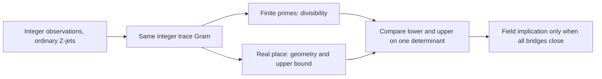

# The Tenth Discriminant

*An AI-assisted investigation of arithmetic, polynomial jets and the geometry of imaginary quadratic fields.*

The question is whether the arithmetic of a number field can force an integer determinant to be **larger** than geometry permits. To be useful, both inequalities must concern **the same integer**, with the same observation points, derivative convention and field hypotheses. This repository explores that requirement through elementary number theory, finite fields, integral linear algebra, convex geometry and Lean.

It began in response to [Terence Tao's experimental tenth-discriminant challenge](https://terrytao.wordpress.com/2026/10/20/an-experimental-ai-math-challenge-using-tenth-discriminant-bounds-to-explore-arguments-ruling-out-siegel-zeroes/). The objective is not simply the smallest decimal cutoff: a proof that can be reconstructed and challenged by another mathematician matters at least as much.

## The current formal result and its review boundary

**Lean-checked mainline statement (2 November 2026).** For any totally complex degree-two number field of class number one, the repository now proves, relative to its encoded definitions and permitted axioms, that the **actual absolute field discriminant** is strictly less than

$
377^4 = 20,200,652,641.
$

Read the [Phase178 actual-field theorem](lean/TenthDiscriminant/ActualField377.lean), [merged PR #97](https://github.com/Dojo-1/tenth-discriminant/pull/97), and its [exact-head whole-library source/axiom/negative audit](https://github.com/Dojo-1/tenth-discriminant/actions/runs/41508959650). Its focused theorem check and security checks passed too. This is **not** a statement about the auxiliary trace-Gram determinant, and it is not a new classification of the nine imaginary quadratic class-number-one fields.

**Independent mathematical reconstruction remains open.** The specification, formalization and most tests share an AI-assisted research lineage. Successful Lean/CI checks verify the *formal declarations*, not that an independent mathematician has reconstructed every intended classical source object and bridge. That independent task, now covering both the new result and its predecessor, is [Issue #50](https://github.com/Dojo-1/tenth-discriminant/issues/50). No external publication, originality, priority or referee approval is claimed.

For a human route through the new argument, begin with the [Phase178 source-to-theorem guide](research/thin_integrated/PHASE178_HUMAN_GUIDE.md). The earlier [41,006,250,000 proof map](research/thin_integrated/HUMAN_GUIDE_CURRENT.md) and [47-billion derivation](research/tight_radial_v1/HUMAN_RECONSTRUCTION.md) remain verified **formal predecessors**, not the current strongest mainline statement. The ongoing **5-billion** and alternative-support studies remain research candidates; see the [evidence ledger](RESEARCH_NOW.md).

The invariant is simple to say and difficult to satisfy: both the arithmetic lower and real-place analytic upper act on **the same original thin-Q integer ordinary-jet trace Gram**, with the unchanged $2,2D$ trace weights. The existing binary prime factor is counted once. The padded ellipse supplies only a bound on the number of observations; its determinant is never substituted for the thin determinant.

## What the determinant remembers

The original observable is the ordinary directional jet

$$
\partial_Z^j(Z^rW^s)=(r)_{\underline j}Z^{r-j}W^s,
\qquad W\text{ held fixed}.
$$

For a finite set `Q` of integer-pair observations, these form an integer matrix `E_Q`. Its positive trace metric `B_Q` has diagonal weights `2,2D`, and we compare the same positive integer

$$
G_Q=E_QB_QE_Q^{\mathsf T},\qquad \Delta_Q=\det G_Q>0
$$

from two directions. **Inert primes** force divisibility of `\Delta_Q`; **the real geometry** of the observation ellipse constrains its size. A jet-normalization or change of sampling set is not free: any arithmetic, rank or metric remainder must be transported explicitly.



## A smaller set that still sees the same polynomial

A separate finite experiment asks a question inspired by **Miguel N. Walsh's characteristic-subset viewpoint**: which observations are actually needed to force the original polynomial to vanish?

For an odd inert witness prime `p`, set `R=p-1` and `S=J≤R`. On the Frobenius graph `W=Z^p`, the original rectangular monomials restrict to `T^{r+ps}`. Their degree is at most `pS-2`. **Exactly `p` distinct conjugate-closed roots are sufficient** for full row rank of the original ordinary-jet matrix: a nonzero polynomial cannot vanish to order `S` at all those roots.

Using **`p-1` roots** is subtler. Rank becomes equivalent to the invertibility of a much smaller `(S-1)×(S-1)` coefficient obstruction. We preserve a concrete counterexample where that matrix is singular. The formula and numerical controls belong to our [Phase158 dossier](research/reverse_determinant/PHASE158_CHARACTERISTIC_JETS.md); they are not Walsh's theorems, nor has this algebraic step been formalized in Lean.

For the illustrative `D=163,p=31,R=30,S=5` case, a characteristic selection uses **26 integer nodes / 31 effective roots**, retains full rank 150 in independent finite-field representations, and raises the guaranteed 2-adic jet-capacity floor from 310 to 430 while reducing the raw diagonal Hadamard upper. These are **finite exact results**, not proof of the all-`D` cutoff.

[Phase158 — readable mathematical dossier](research/reverse_determinant/PHASE158_CHARACTERISTIC_JETS.md) · [Exact verifier](research/reverse_determinant/phase158_characteristic_jets.py) · [Full Phases144–158 research index](research/reverse_determinant/README.md)

## Which arithmetic results have actually been proved?

The distinction between a **polynomial jet**, an **integer Gram determinant**, and a **field discriminant** is central to this project.

- **Phase162 — a proved determinant divisor.** An explicit unimodular integer change of the **original** rectangular ordinary-jet rows yields `2^Λ₁(R,S) ∣ det G_Q` for any source observation set `Q`. It is [formalized in Lean](lean/TenthDiscriminant/BinaryNullTraceGram.lean), with `Λ₁(R,S)=RS+2S Σ_{r<R} ⌊r/4⌋`. At `R=30,S=5`, the exponent is **1,130**.
- **Phase163 — proved local four-generator jets, not yet a Gram divisor.** [Lean](lean/TenthDiscriminant/BinaryNullFourSourceJets.lean) checks that `F(Z)=Z⁴−Z²`, `H(Z,W)=Z²−W²`, `F(W)=W⁴−W²`, and `K(Z,W)=Z²(W²−1)` have even **ordinary Z-derivatives** at true source observations with `W=conj(Z)`, and that their product powers accumulate binary factors. [PR #81](https://github.com/Dojo-1/tenth-discriminant/pull/81) passed the exact-head whole-root Lean, source, axiom and negative-control checks before merging. The **1,358** four-generator Gram exponent remains a *paper derivation plus finite controls*: its unitriangular rectangular row-action theorem is **not yet in Lean**.
- **Phase164 — the same thin Gram, two coprime prime families.** [PR #83](https://github.com/Dojo-1/tenth-discriminant/pull/83) instantiates the *already proved* univariate binary divisor and the *odd-only* prime product on **the identical thin-Q Gram** used by the 41.00625-billion theorem. Its [focused Lean test](https://github.com/Dojo-1/tenth-discriminant/actions/runs/41417192952) and [combined-head whole-root Lean, source, axiom and negative-control run](https://github.com/Dojo-1/tenth-discriminant/actions/runs/41417184165) **passed**; it merged as [PR #83](https://github.com/Dojo-1/tenth-discriminant/pull/83) on 2 November 2026. The binary prime **must not be counted twice**. Phase164 alone established no improved field cutoff; the subsequent Phase178 formal theorem composes this exact divisor with new lower-threshold geometry.
- **Phase165 — the exact amount of that binary factor.** [Lean](lean/TenthDiscriminant/BinaryExponentNormalization.lean) establishes `4Λ₁(R,S)=S(R²+t(4−t))`, where `t=R mod 4`; thus `4Λ₁≥SR²` and the normalized binary log term is at least `¼ log 2` when `R,S>0`. [PR #84](https://github.com/Dojo-1/tenth-discriminant/pull/84) merged after focused Lean and source-equivalent whole-root compilation/axiom checks; the expensive negative-control rerun was still pending at merge, but subsequently [completed successfully](https://github.com/Dojo-1/tenth-discriminant/actions/runs/41426817963), closing that verification obligation. [Read the short mathematical derivation](research/thin_integrated/PHASE165_EXACT_BINARY_NORMALIZATION.md).
- **Phase166 — the logarithm of the original positive determinant.** [Merged PR #85](https://github.com/Dojo-1/tenth-discriminant/pull/85) proves in Lean, **for arbitrary original finite Q with explicitly positive trace-Gram determinant** and the original arithmetic hypotheses, `Λ₁ log 2 + exactOddPrimeMass ≤ log(det G_Q)`. This preserves ordinary Z-jets, the 2,2D trace pairing and the *odd-only* prime product. Its [focused Lean proof](https://github.com/Dojo-1/tenth-discriminant/actions/runs/41429815246), whole-library compilation, source correspondence and permitted-axiom audit passed at the merge checkpoint; the extensive negative-control suite [subsequently completed successfully](https://github.com/Dojo-1/tenth-discriminant/actions/runs/41429815239). The high-D thin-ellipse specialization is already ruled out by the existing field theorem; **this is a reusable arithmetic lemma, not a new discriminant cutoff**. [Human proof guide](research/thin_integrated/PHASE166_SAME_GRAM_LOG.md).

For the compact proof history, the exact-source D=7 controls are [Phases167–168](https://github.com/Dojo-1/tenth-discriminant/pull/87); the sound logarithmic floor and lower-threshold interpolation are [Phases169–170](https://github.com/Dojo-1/tenth-discriminant/pull/89), followed by [Phase171's original radius estimate](https://github.com/Dojo-1/tenth-discriminant/pull/90). The unchanged prime-mass, binary and original-Gram positivity files from Phases172–174 were merged **together** as [PR #94](https://github.com/Dojo-1/tenth-discriminant/pull/94); their individual verified PRs #91–#93 were then closed as superseded, not merged twice.

The critical remaining source-preserving steps were merged as [Phase176 scalar upper](https://github.com/Dojo-1/tenth-discriminant/pull/95), [Phase177 same-thin-Gram determinant upper](https://github.com/Dojo-1/tenth-discriminant/pull/96), and [Phase178 actual-field endpoint](https://github.com/Dojo-1/tenth-discriminant/pull/97). [Issue #82](https://github.com/Dojo-1/tenth-discriminant/issues/82) is closed for this technical integration, while [Issue #50](https://github.com/Dojo-1/tenth-discriminant/issues/50) remains open for genuinely independent semantic reconstruction. A repository test and a human proof audit answer different questions.

The [quarantined Phase157 π-window attempt](research/graveyard/PHASE157_PI_WINDOW_UNCOMPILED.lean) is retained as a reproducible historical compile failure, not used in a promoted result.

## Exact sampling witnesses — less is not always better

[Phase142](research/ellipsoid_trimming/PHASE142_LEVERAGE_AND_UNISOLVENCE.md) studies how many **original ordinary-jet** observations can support full rank, and the real determinant cost of dropping nodes. On the finite D=19, R=8, S=J=4 example, an exact four-*nonreal*-node matrix attains the necessary 32 observation channels and is invertible, despite failing the traditional sufficient ellipse cardinality count. The same exact experiment finds a **larger**, not smaller, log determinant than an eight-real-node witness, and retains the inert 3-adic factor when separately re-applied to the new Q. The finite real-axis Vandermonde^S factorization has a paper-level proof, not a universal thin-Q field bound or Lean proof. [Exact regression](research/ellipsoid_trimming/phase142_complex_minimal.py) · [Leverage controls](research/ellipsoid_trimming/phase142_leverage.py) · [PR #61](https://github.com/Dojo-1/tenth-discriminant/pull/61).

## Observation symmetries and their limits

[Phase159](research/reverse_determinant/PHASE159_OBSERVATION_CONTINUUM.md) treats different ordinary-jet observation supports as related real Grams, while retaining distinct integer lattices and prime-adic invariants. [Phase160](research/reverse_determinant/PHASE160_ARITHMETIC_NEURITES.md) identifies the exact cokernel gluing remainder of overlapping supports. Both are finite research programmes, **not** replacements for either checked actual-field theorem.

[Phase161](research/reverse_determinant/PHASE161_SYMMETRY_GUIDE.md) keeps only source-preserving symmetries: conjugation of the original integer observations, the already known parity/inversion action, and the existing integral translation action. It derives a parity split of the characteristic-root rank obstruction, with explicit successful and failing finite controls. Symmetry alone does **not** make deleting the central root safe; the D=3, p=11 control fails by one rank. The [small Lean conjugation module](lean/TenthDiscriminant/ObservationConjugation.lean) passed its [focused exact-source Lean check](https://github.com/Dojo-1/tenth-discriminant/actions/runs/41333553256) against pinned Mathlib; the [finite regression](https://github.com/Dojo-1/tenth-discriminant/actions/runs/41333553063) also passed. The whole-root audit of the merge remains a separate check. The speculative Spin/Pin and free intermanifold lifts are [not promoted](research/graveyard/PHASE161_DEFERRED_LIFTS.md). No new cutoff follows.

## Reconstruct the evidence

The project pins **Lean 4.19.0** and **Mathlib `c44e0c8ee63ca166450922a373c7409c5d26b00b`**. For the finite characteristic-set experiment, from repository root:

```sh
python3 -m pip install sympy==1.14.0 mpmath
python3 research/reverse_determinant/phase158_characteristic_jets.py
```

For the formal library:

```sh
cd lean
lake exe cache get
python3 verify_sources.py
lake build
python3 audit.py
python3 negative_controls.py
```

Exact-head checks are in [finite workflow](.github/workflows/reverse-determinant-finite.yml) and [Lean workflow](.github/workflows/lean.yml). A green finite test certifies its tested matrices, not a universal number-field argument; a clean Lean build checks encoded statements, not their semantic correspondence with a historical claim. [Independent review](https://github.com/Dojo-1/tenth-discriminant/issues/50) and [cross-method transport](https://github.com/Dojo-1/tenth-discriminant/issues/51) remain open.

## Sources, attribution, and intellectual boundaries

This is cumulative mathematics. **Terence Tao** posed the [challenge](https://terrytao.wordpress.com/2026/10/20/an-experimental-ai-math-challenge-using-tenth-discriminant-bounds-to-explore-arguments-ruling-out-siegel-zeroes/) and developed the surrounding [adelic determinant perspective](https://terrytao.wordpress.com/2026/10/19/a-sketch-of-the-proof-of-non-existence-of-siegel-zeroes/). The derivative-determinant approach is credited to **Ben Green**; **Roelof van Dijk's** finite-field nonvanishing method and **Kyle Pratt's** disk-interpolation suggestion are distinct antecedents discussed in Tao's thread. **twinheterodox, Peter Murphy, Antoine Olivier**, and other contributors have obtained or formalized related arguments, often with substantially stronger cutoffs. See our [dated prior-art ledger](PRIOR_ART.md) and [source-aware comparison](METHOD_COMPARISON_CURRENT.md). These citations do not imply collaboration or endorsement.

**Miguel N. Walsh** deserves specific credit for the *question* behind the new characteristic-support experiment, not for proofs he has not asserted about this construction:

- [*Characteristic subsets and the polynomial method*](https://www.mathunion.org/fileadmin/ICM/Proceedings/uploads/ICM-2018-vol2-ver1-eb.pdf), Proceedings of ICM 2018, vol. II, pp. 485–504 — characteristic subsets and polynomial vanishing.
- [*The inverse sieve problem in high dimensions*](https://doi.org/10.1215/00127094-1645788), *Duke Mathematical Journal* **161** (2012), 2001–2022 — modular sparsity and algebraic structure.
- [*The polynomial method over varieties*](https://doi.org/10.1007/s00222-020-00975-6), *Inventiones mathematicae* **222** (2020), 469–512 — polynomial geometry adapted to varieties.

The specific root-counting, Hermite interpolation, coefficient obstruction, Cauchy–Binet and factorial divisibility steps use **classical mathematics**. Our application and the experiments were developed under **Jesús Vilela Jato's (Dojo-1) research direction**, with substantial assistance from AI systems for exploration, source drafting, code, Lean and critical checking. Those systems are not independent referees. No claim of priority, validation by cited mathematicians or new published theorem is made here.

The longer earlier README is [preserved verbatim in the research archive](research/archive/ROOT_README_BEFORE_PHASE158_2026-11-01.md), rather than continuing as an unmaintainable running log. Mathematical corrections are welcome as an exact failed lemma, counterexample, mismatched normalization or reproducible test—not as an appeal to confidence.
