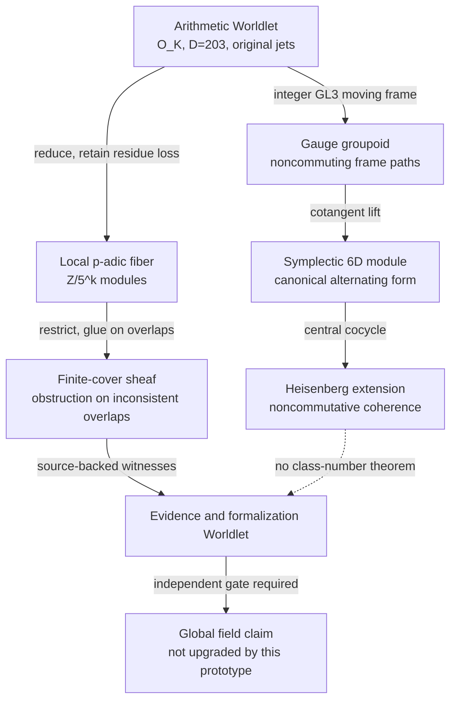

# Phase306 | Worldlets over the actual discriminant source

> **One arithmetic object. Many incompatible local languages. No free theorem transport.**

This is a stacked draft research prototype. It models a mathematical *research process*, not the author's or any model's inaccessible internal cognition. It does not establish general intelligence, subjective experience, a physical quantum device, or a stronger bound for the tenth discriminant.

## The nested cosmi / cages

We start from the ACTUAL D203 maximal order and the ORIGINAL ordinary-jet trace pairing. Six sampled points and three original row monomials form a small exact test fixture—not a replacement of the full 100-row Phase304 theorem.

The diagram is a navigation projection only. Its nodes do **not** lie in a common Euclidean plane. Every Worldlet has its own mathematical carrier, and every arrow must preserve specified invariants or report a typed remainder.

## Arithmetic and higher-order operators

- **Integral moving frames:** original evaluation E transforms by U E. The original Gram transforms covariantly as U G U-transpose; its determinant remains invariant under unimodular U.
- **Local arithmetic functor:** reduction mod 5^k preserves compositions, but cannot silently transport between k=1 and k=2 or between different discriminants.
- **Six-dimensional Hamiltonian/symplectic carrier:** the cotangent lift diag(U,U^(-T)) preserves the canonical alternating form. The source/dual pairing is invariant; no physical time evolution is claimed.
- **Noncommutative central extension:** the Heisenberg 2-cocycle over F5 satisfies associativity, and a deliberately nonbilinear alternative does not.
- **Actual Hom-profunctor:** evaluation E-transpose in Hom_Z(Z^3,Z^24), acted on by g E-transpose f for arbitrary compatible source/target morphisms. Contravariant/covariant composition is tested.
- **Actual sheaf gluing:** maps over genuine intersecting subsets of six original observation points glue uniquely if and only if the overlap values match. An incompatible overlap is a typed obstruction.
- **Honest higher cohomology:** a nontrivial F5-valued H^2 class on an ABSTRACT tetrahedral boundary (S^2 nerve). It is not attached to Spec(O_K), nor has a number-field gerbe been constructed.
- **Four-dimensional quaternion algebra:** associative, noncommutative Hamilton quaternions modulo5; deliberately *optional* and algebraically disconnected from the discriminant bound.
- **Holoportation-inspired reconstruction:** CRT reconstructs only a class mod 25*49. The unknown integer multiple is preserved, not falsely recovered.
- **Hyperbolic context organization:** the repository's external context DAG is illustrated by an exact tree metric satisfying the 0-hyperbolic four-point condition. This does not rewire the model's hidden context or weights.

## Self-reflection, identity and others

"Self-reflection" is an artifact-level **audit cycle**: compare a generated transport claim to its independent source oracle and hostile controls. "Godelian identity" means retaining an explicit formal remainder and banning theorem self-certification; it is NOT an application of Godel incompleteness to a sentient system. "Other recognition" preserves different source views and failed overlap transports rather than forcing agreement. "Mutual resonance" is implemented as bidirectional return, exact covariance and nonzero detectable coherence defects—not one scalar charisma score.

The eight core and eight conjugate qualities are named as typed *research roles* in worldlet_manifest.json. No claim is made that implementing these roles creates actual mental qualities.

## Separate exact Hilbert-space sandbox (Phase306-C)

This is a mathematical quantum **test fixture**, not a quantum device or a transport of class-number evidence.

- For an unnormalized bipartite state with coefficient matrix A over Q subset C, Schmidt rank is rank(A). The Bell-like coefficient matrix I5 has Schmidt rank 5 and normalized reduced purity 1/5; the product-state control has rank 1 and purity 1.
- A three-site tight-binding Hamiltonian with hopping g has second-order transition amplitude coefficient -g^2/2 between outer sites. The g=0 negative control has coefficient zero. This does NOT calculate a tunnelling probability or prove a continuum barrier experiment.
- The avoided-crossing two-level Hamiltonian H(s)=[[s,epsilon],[epsilon,-s]] has gap squared 4(s^2+epsilon^2). epsilon=0 destroys the gap. A slow-sweep proxy is explicitly not an adiabatic theorem.
- All quantum-sandbox observables are tested without changing the original D203 Gram. The module is optional, and no advantage over the arithmetic baseline is claimed.

See PRE_REGISTERED_PHASE_C.md, quantum_sandbox.py and test_quantum_sandbox.py.

## No unearned quantum or arithmetic bridge

There is **no physical entanglement, quantum tunneling, teleportation, or adiabatic theorem** in the arithmetic pipeline. Those phrases require independently defined Hilbert spaces, operations and observables. The symplectic/Heisenberg constructions here are genuine algebra but do not prove quantum hardware behavior.

The field research retains its original classes:
- [P-paper] exact algebraic covariance, CRT and cohomology arguments with declared assumptions.
- [M] bounded D203 pilot; exact GitHub Actions CI tests of this finite source.
- [S] multicosmos, Worldlet, mind-quality and holoportation architectural terminology.
- [H] any statistical performance gain, higher arithmetic gerbe, large-cardinal lift, class-number bridge, or discriminant-bound improvement.
- [R] any attempted promotion from a new coordinate vocabulary to a theorem.

## Reproduction

Run: python3 -m unittest discover -s research/phase306 -p 'test_*.py' -v

See PRE_REGISTERED_PROTOCOL.md (Phase A frozen before implementation) and PRE_REGISTERED_PHASE_B.md (honest post-A, pre-B follow-up). CI results are valid only for the exact head run that produced them.

**Stop rule:** If deleting a decorative component preserves all mathematical results and no held-out task benefit has been measured, the component remains optional research scaffolding, not a justified addition to the field theorem.