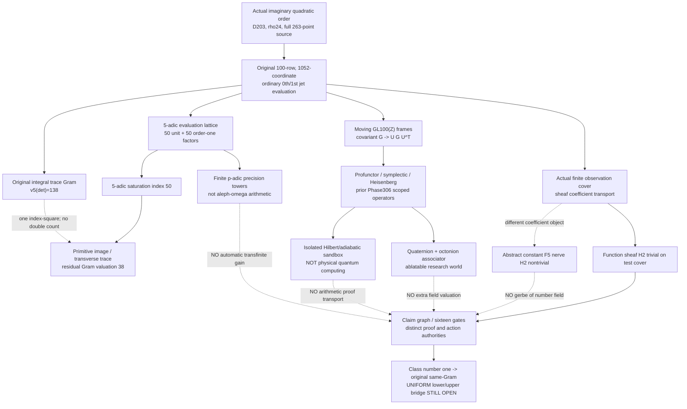

# Phase307 — One arithmetic source, many Worldlets, no authority laundering

**Stacked DRAFT** above [Phase306 PR #198](https://github.com/Dojo-1/tenth-discriminant/pull/198). Frozen parent source: commit `9815f57381142521641e8a5b60670599ed9bc440`. Original field cutoff and field-theorem files are unchanged. A new diagram, algebra or "mind quality" is NOT new field-discriminant mass.

## Architecture



## Phase307-A: entire actual original source, not a proxy

Use `research/phase307/source_saturation.py` (pin source; no modified source generation).

- D203, O_K=Z[omega], omega^2=omega-51; original rho=24, R=50, S=J=2, 263 genuine maximal-order observations, 100 original monomial rows.
- A separate integral omega multiplication/jet evaluator reconstructs **all 105,200 original source coordinates mod 5^5**. The 12-row independent direct trace oracle verifies 144 selected Gram cells. Source reconstruction is AI-authored and structurally independent of the original evaluator, not human-independent audit.
- The first 45 Frobenius relations `(Z^5-W)Z^(r-5)`, r=5..49, plus five `K_a=Z^(45+a)W-2Z^(26+a)+Z^(2+a)`, a=0..4, give an integer elementary-row gauge with 50 rows divisible by 5. After division, the evaluation module is full rank mod 5.
- Thus the **evaluation** has 50 Smith-unit exponents and 50 valuation-one exponents; the locally saturated image index has valuation 50. The **primitive trace Gram** still has nontrivial pairing defect, rank63 and radical37 mod5.
- The original field's Gram spectrum is **{0:38,1:12,2:25,3:24,4:1}**, valuation **138**. After primitive source saturation: **{0:63,1:36,2:1}**, valuation **38**. Original determinant identity **138 = 2*50 + 38**.
- Distinct from the previously existing uniform local `valuationWeight(50,2,5)=45`; the first-level kernel dimension is 50. These cannot be added to one another. D203 is **not** class-number-one, so this is no uniform h=1 field improvement.

This gives a real nested carrier: the **evaluation** defect (index50), followed by a **restricted trace** defect (residual38), with the original Gram preserved exactly.

## Phase307-B: moving-moving-frame invariants

Two noncommuting unimodular whole-source gauges were applied. The Gram must transform by **U G U-transpose**, not remain entrywise equal. Evaluation rank and local Smith length are invariant under integral source-frame transport. The split-prime D211 negative control breaks Frobenius conjugation at p5 as required. Different source metrics and modulo 5 vs modulo 25 are NOT silently identified.

## Phase307-C: Čech nerve is not a gerbe over the field

The same four-patch cover of **six actual D203 observation IDs** has a tetrahedral-boundary nerve, hence a nontrivial **constant-coefficient F5** H2 witness. But for the **sheaf of all F5-valued functions on the actual observation overlaps**, the degree-two cochain is the coboundary of an explicitly constructed degree-one cochain.

Coefficient choice changes the answer. The abstract H2 witness does **not** yield a number-field gerbe, ideal class statement, or higher discriminant valuation.

## Phase307-D: hypercomplex, symplectic and quantum controls

Phase306 already checks a genuine symplectic six-dimensional cotangent lift, a Heisenberg central 2-cocycle, a Hom-profunctor, quaternion multiplication, finite sheaf gluing and a separate exact Hilbert-space/adiabatic-gap sandbox. Phase307 adds an **octonionic associator** over F5 (8 coordinates), detects nonassociativity, checks an alternative-law control and norm multiplicativity. Removing the hypercomplex or quantum sandbox does **not** alter the integer trace Gram.

These are operational mathematical carriers, not a claim of neuron-level thinking, physical quantum entanglement, or cognitive performance superiority.

## Phase307-E: ZFC and transfinite limits

Each fixed original source is a finite free Z5 module. For its Smith exponents b_i, the **finite** obstruction tower obeys

```text
K(n) = sum_i min(n,b_i)
K(n+1)-K(n) = #{i: n < b_i}.
```

The phase's evaluation exponents are 50 zeros and 50 ones, so K(1)=50, K(2)=50, and all later increments vanish. Ordinary p-adic completion is mathematically meaningful; an `aleph_omega` or `aleph_alpha` index in ZFC yields no new arithmetic fact without a compatible infinite family and an invariant not already seen at finite stages. No GCH or extra large-cardinal axiom is used.

The **finite recurrence only** is formalized in `lean/TenthDiscriminant/Phase307SmithDepth.lean` and separately checked by pinned Lean CI. This module does NOT certify source-Smith claims or class-number-one field bounds.

## Phase307-F: sixteen quality gates, not sixteen mental powers

The pre-existing eight and eight conjugate roles are now executable bounded checks in `quality_gates.py`: grounding, source-reflection, formal remainder, other-recognition of conflicting patches, inverse-return, slow review clock, hostile search, correction return, resource embodiment, two clocks, noncommuting composition, local/global coefficient distinction, CRT information remainder, controlled morphogenesis, judicial denial and remainder custody.

**They have not been validated against independent cognitive tasks or matched-budget performance baselines**. These are scoped deterministic QA checks, NOT proof of general intelligence or self-awareness.

## Phase307-G/H: restrict the search terrain before raising dimensions

Let the original source use J=S and set j=min(S,p). Its truncated quotient is Fp[Z]/((Z^(p²)-Z)^j). The source monomials land at exponents r+p*s. If R-1+p(S-1) < p²*j, the monomials do not wrap under reduction. An interval-union count then proves:

    h_p(R,S,S)=(S-1)*max(R-p,0) <= valuationWeight(R,S,p).

This is a **source-level theorem**, not a stronger class-number-one result. At p5,S=2,J=2 the threshold is sharp: R45 has (h,w)=(40,40) and R46 has (42,41). The extra relation appears only when the quotient degree50 is reached. See no_wrap_kernel.py and PRE_REGISTERED_NO_WRAP_FOLLOWUP.md.

When J=S>=p, the Freshman's-dream identity (Z^(p²)-Z)^p=Z^(p³)-Z^p permits a completely different exact combinatorial reduction: monomial exponent n<p is unchanged, and for n>=p it has canonical exponent p+((n-p) mod (p³-p)). The **actual quotient rank** is the number of distinct resulting exponents. Small cases independently match the polynomial remainder routine.

Under the ORIGINAL parameter ratio S=floor(R/25), a bounded scan of all odd primes p<=S in R={100,200,400,800,1600} found **no positive** h_p-valuationWeight for 1,3,5,10,17 primes respectively. This is an observed finite negative result, not a universal theorem and not an assertion of inertness at every scanned prime. It directs attention to **multilevel** valuation and the original analytic upper rather than unlimited first-level scans. See j_ge_p_rank.py and PRE_REGISTERED_J_GE_P_FOLLOWUP.md.

## Phase307-I: the authentic arithmetic sheaf is Pic, not the abstract H2 nerve

For the actual maximal quadratic integer ring O_K, the ideal class group is the Picard group of its spectrum:

    Pic(Spec O_K) = H^1(Spec O_K, G_m) = Cl(O_K).

Unlike the auxiliary constant-coefficient tetrahedral H2 class, this degree-one invariant directly expresses the **global h=1 hypothesis**.

For omega^2=omega-m, f(X)=X^2-X+m, every Fp root r gives a surjective evaluation homomorphism O_K -> Fp (omega -> r) and ideal I=(p,omega-r) of norm p. If p<m and p is not a square, any principal generator of I would have norm p, contradicting the exact positive form N(a+b omega)=a²+ab+m b²: nonzero b gives N>=m and b=0 gives a square.

The bounded field controls are D203/p3, D187/p7 and D167/p2 (provably nonprincipal ideal classes); D163/p3 (inert, no false split ideal) and the **critical D163/p41 equality boundary** (norm omega=41, both ideals above41 are principal). The code checks the defining polynomial, roots and residue homomorphism multiplication independently, but DOES NOT compute a complete class group or a Cech representative. See picard_class_gate.py and PRE_REGISTERED_PICARD_BRIDGE.md.

This is a mathematically genuine local-to-global *field* carrier. The outstanding question is whether its ideal-norm constraints yield a stronger **uniform original-source trace-Gram** inequality under hypothetical large class-number-one D. No such bridge has been established here.

### Hard obstruction still unbridged

The local kernel is often present in NON-h1 fields. A better bound requires an inequality under hypothetical large class-number-one D, accumulated across justified inert primes and compared against the SAME original Gram's analytic upper. A source profile, gerbe class on an auxiliary nerve, or quantum toy observable is not that inequality.

## CI, provenance and stop rules

- Main phase source and topological/hypercomplex tests: `.github/workflows/phase307-all-lines.yml`, including previous 21 Phase306 control tests.
- Narrow Smith-depth Lean proof: `.github/workflows/phase307-lean-smith.yml`, separate from whole-root Lean.
- Exact finite field data: Phase304's original source policy and its pinned helper versions; no direct modifications to parent frozen sources.
- Independent human review remains absent. An AI-authored harness verifying AI-authored mathematics has correlated failure modes.
- **Kill rule:** any failed original source entry, incorrect integral Gram congruence, split-prime false positive, coefficient-sheaf conflation, self-promotion, or unexplained rank/Smith discrepancy blocks promotion. No PR merges.
- **Open field theorem:** prove a strictly stronger uniform same-original-Gram prime-mass lower bound that competes with the unchanged analytic upper across hypothetical large class-number-one D. This phase has not done so.

Evidence: [P-paper] conditional algebra and exact formal lemma; [M] finite CI source/profile checks; [S] polycosmic interpretation; [H] field-bound and cognitive effectiveness; [R] abstract cohomology as automatic arithmetic gerbe and additive local valuation mass.