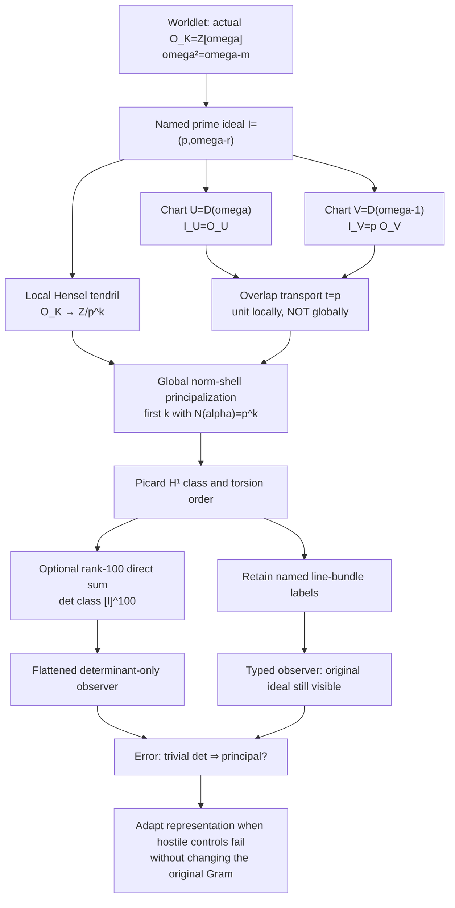

# Phase308 | Picard Tendrils — **sapere aude**

> **A global frame can look trivial while its named local lines are not.**
>
> One ideal. Two local charts. Four powers. A real obstruction—and a precise place where flattening erases it.

This is a stacked, unmerged research draft on [Phase307](../phase307/README.md). It creates an OPTIONAL ideal-twisted coefficient-worldlet, NOT a substitute for the original 100-row integer polynomial source of the tenth-discriminant project. The existing bound, source and Gram remain unchanged.

## Arithmetic → local charts → obstruction → adaptation

The connections are typed. The actual Čech cohomology is in degree **one** with coefficients in G_m on Spec(O_K), **not** the prior abstract tetrahedral-nerve H². Every Hensel residue is a finite local approximation, not a claim of global principalization.

## A complete exact witness — D=203

Let omega²-omega+51=0, I=(3,omega) and J=(3,omega-1). Then I J=(3) and

    I^4 = (omega-6),  N(omega-6)=81=3^4.

The test enumerates **all** integral O-ideal generators of I⁴ and checks that each is exactly divisible by omega-6, plus the index equality 81. For exponents 1,2,3, norm and a Hensel residue rule out principality. Thus [I] has exact order 4. The same class-number-four count is independently reproduced by classical reduced forms.

A legitimate two-open cover is U=D(omega), V=D(omega-1): omega-(omega-1)=1. The local ideal generators are 1 on U and 3 on V; the overlap transition is t=3. It cannot be globally trivialized because I is not principal. However its **fourth tensor power** is a coboundary: t⁴=81, globally trivialized by omega-6 with explicitly checked local inverse identities.

## Three further worlds — 1,2,4,11

A complete exact norm-shell search uses

    4N(a+b omega) = (2a+b)^2 + D b^2,

and coherent Hensel roots to test EVERY candidate through the first principal ideal power. The four case-study outcomes are:

| D | p | First principal ideal power | Explicit generator |
|---:|---:|---:|---|
| 163 | 41 | 1 | omega |
| 187 | 7 | 2 | omega-2 |
| 203 | 3 | 4 | omega-6 |
| 167 | 2 | 11 | 7omega-2 |

At D=167 the prime-adic root at depth 11 is 878 modulo 2¹¹, and N(7omega-2)=2048. All lower levels are exhaustively ruled out by exact quadratic norm-shell arithmetic, not merely by a bounded rectangular scan. Counts of reduced binary quadratic forms independently reproduce class numbers 1,2,4,11 *under the standard classical reduction correspondence*.

## A real representation discriminator

By Steinitz classification of projective modules over Dedekind domains, the **separate experimental** rank-N O-module M_N=I ⊕ ... ⊕ I has determinant class [I]^N and is abstractly free iff [I]^N=1.

At N=100, this class is trivial for D=163,187,203 but nontrivial for D=167. Nevertheless the individually named lines are nonprincipal at D=187 and203. A deliberately naive determinant-only "trivial class ⇒ original I principal" predictor is wrong on those two examples (2/4 on this in-sample set). The explicit Picard-class representation distinguishes all four (4/4 by its exact certificates).

**This is an *in-sample, predetermined algebraic information-loss demonstration*, not a statistically measured cognition improvement, an independently validated benchmark, or evidence of sentience.** In particular it does not imply that the original Gram determinant loses arithmetic information in this same way: we changed the type of the source for this experiment, and that distinction is intentionally protected.

## Hard evidence and stop rules

- Pre-test protocol: PRE_REGISTERED_PICARD_TENDRILS.md; after locally discovering the four-field candidates, a separate **post-discovery but pre-code** validation protocol: PRE_REGISTERED_TORSION_FAMILY.md.
- Code: picard_tendrils.py, adaptive_torsion_family.py and their hostile test suites; exact GitHub workflow: phase308-picard-tendrils.yml.
- Original Phase307 Picard norm tests and Phase306 mathematical controls are re-run. The formal bound has not been altered, and no merge is authorized.
- [P-paper] standard ideal/Picard and Steinitz arguments with explicit equations; [M] bounded computational certificate after exact-head CI; [S/H] geometric knowledge-tendril and adaptation interpretation; [R] "an aggregate determinant tells us whether its named summand was principal".
- **New field bound:** none. **Proved quantum effect:** none. **Measured general intelligence:** none. **Independent human referee:** none.

Reference for classical prior art: [Steinitz classification and module classes over Dedekind domains](https://openmaths.org/courses/NT-ANT/norms-class-groups-and-modules-over-dedekind-domains.html).

**New research question:** Can a class-group-twisted local observation bundle yield an *independent, non-overlapping* obstruction in the full original arithmetic source **after** a legitimate comparison map has been constructed? This requires an explicit same-source interface, not a claim made from visual similarity.
