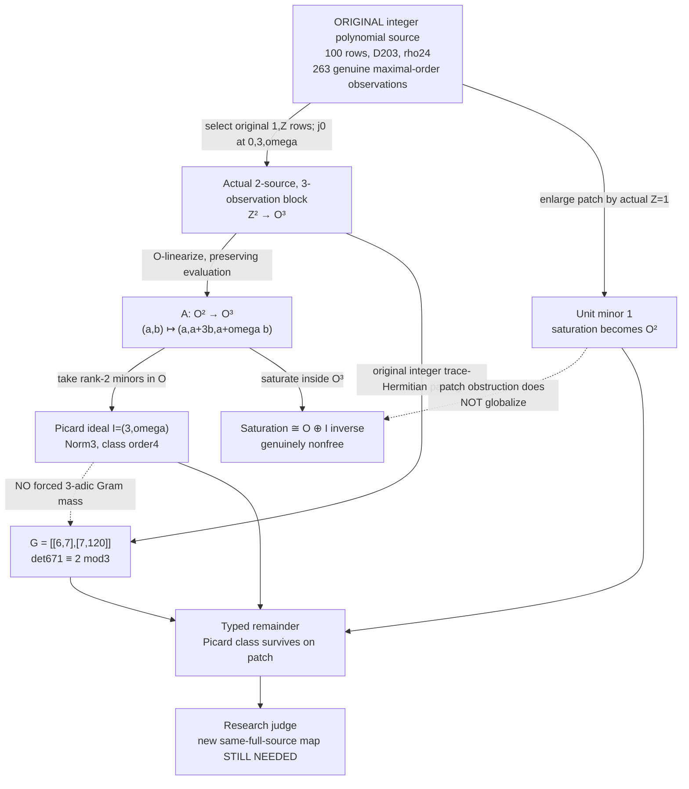

# Phase309 | The Picard obstruction that the Gram cannot see

> **The original arithmetic source really carries an ideal-class shadow.**
>
> **Yet even on the same observation patch, its trace Gram can be a prime-adic unit.** The inability to transport that shadow into determinant mass is now *demonstrated*, rather than assumed.

This is a stacked, unmerged DRAFT on [Phase308](../phase308/README.md) and the actual original tenth-discriminant source. The reported 322^4 field bound and all original 100-row source/Gram files are unchanged. We have **not** proved a new field theorem or cognitive performance result.

## One diagram, several mathematical species

**What is original?** The source rows 1,Z, their j=0 values, and the integer trace metric are from the existing source. **What is new?** Choosing a true subset of observations, allowing O-linear coefficients through the canonical O-linearization of the Z-linear evaluation map, and examining its saturated image and maximal-minor ideal. These operations are typed and are **not** presented as an invertible Z-integral moving-frame gauge of the original 100-row source.

## Mathematical theorem: a genuine ideal from a restricted evaluation

Take a squarefree D=3 mod4, O=Z[omega], omega²=omega-m, m=(D+1)/4. Let p be a rational prime, and r an integer residue satisfying

    f(r)=r²-r+m ≡ 0 mod p,
    f'(r)=2r-1 ≠ 0 mod p.

Write z=omega-r. Provided 0,p,z are in the ACTUAL original observation set and 1,Z occur among its rows, choose that submap:

    A(a,b) = (a, a+p*b, a+z*b).

The maximal minors are p,z,z-p, generating the prime ideal I=(p,z). An explicit saturation computation gives

    Sat_O(im A)
      = {(a,a+pb,a+zb): a∈O, b∈I^(-1)}
      ≅ O ⊕ I^(-1).

Proof: the first coordinate demands a∈O; subtract it from the other coordinates and obtain pb∈O and zb∈O, i.e. b∈I^(-1). Invertibility of I follows because O is a Dedekind domain. For nonprincipal I, this rank-2 projective is nonfree by the classical Steinitz theorem.

Concrete strict-saturation witness:

    b=conjugate(z)/p ∉ O,
    p*b=conjugate(z) ∈ O,
    z*b=Norm(z)/p ∈ O.

Thus the saturation is a genuinely larger integral observation module, even while the original two source rows have free integer coefficients.

## The inconvenient counterworld: trace-Gram determinant is a p-unit

The ORIGINAL restricted integer trace Gram is exactly

    G = [[6, 2p+1-2r],
         [2p+1-2r, 2(p²+f(r))]].

Therefore

    det(G) = 12(p²+f(r)) - (2p+1-2r)²
           ≡ -(1-2r)² (mod p).

At any simple split root this residue is nonzero. Hence the local ideal Fitting class, *even when nonprincipal*, does NOT force extra v_p(det G).

Exact original-source controls:

| D | p | r | Named Picard ideal class order | Original patch G | det(G) | det mod p |
|---:|---:|---:|---:|---|---:|---:|
| 203 | 3 | 0 | 4 | [[6,7],[7,120]] | 671 | 2 |
| 187 | 7 | 2 | 2 | [[6,11],[11,196]] | 1055 | 5 |
| 167 | 2 | 0 | 11 | [[6,5],[5,92]] | 527 | 1 |

D203 also matches selected coordinates of BOTH original ordinary jets against the actual frozen 100×1052 Phase304 evaluation source at all preregistered patch points; D187/D167 use the native original source parameter policy and actual maximal-order norm ball. **These are restricted j0 patches, not whole-field Gram calculations.**

## Honest gluing outcome: enlarging the cover kills this class

The full original maximal-order norm ball also contains observation 1. Add it to the same map:

    A'(a,b)=(a,a+pb,a+zb,a+b).

The 2×2 minor from the 0 and 1 observations is 1. Its determinant ideal is O; its saturated image is free. Therefore this PARTICULAR rank-2 Picard obstruction does not survive expansion to the full observation set. It cannot be treated as a global nonprincipal Steinitz class for the complete original evaluation map.

The D163/p41 principal control is also correctly **rejected as an original patch**: z=41 lies outside the native D163 original norm-ball. Pure ring-level principalization is one thing; source-faithful observation support is another.

## Why this affects our larger Worldlet programme

A single evaluation map has at least three noninterchangeable observers:

- **Picard/Fitting:** prime ideal class of maximal minors and integral saturation of the O-linearized restricted map.
- **Trace Gram:** original integer trace pairing, which may be a p-adic unit.
- **Observation cover:** whether an obstruction persists or disappears when the set of actual observations changes.

No scalar summary can certify equivalence of these three typed observations. A tendril between them must be allowed to return a **nonzero mathematical remainder**.

The result is negative for one proposed field-bound mechanism but positive for representation design: we now have a source-faithful example proving that a plausible arithmetic signal can disappear under a different observer, and can disappear again upon enlarging the local chart.

## Status and reproduction

- [PRE_REGISTERED_SOURCE_PICARD.md](PRE_REGISTERED_SOURCE_PICARD.md) was committed BEFORE code and predicted the numerical patch values and hostile controls.
- [original_source_picard.py](original_source_picard.py) replays the original D203 matrix and independent O-ideal norm/Fitting/saturation certificates; [test_original_source_picard.py](test_original_source_picard.py) exercises hostile cases.
- [Phase309PicardGramBoundary.lean](../../lean/TenthDiscriminant/Phase309PicardGramBoundary.lean) formalizes ONLY the residue-field polynomial reduction and nonzero determinant for a simple root. It does NOT formalize the entire Dedekind/Picard theorem or field cutoff.
- Focused CI [phase309-original-picard.yml](../../.github/workflows/phase309-original-picard.yml); isolated Lean [phase309-lean-picard.yml](../../.github/workflows/phase309-lean-picard.yml).

**Evidence:** [P-paper] elementary saturation and determinant-reduction argument with classical Dedekind theory; [M] finite original patch and hostile tests when exact-head CI passes; [H] *some different* obstruction surviving the complete original source and improving its global bound; [R] "local nonprincipal Picard ideal forces additional p-adic trace Gram determinant valuation." No novelty claim for classical ideal theory, no unreviewed [P-Lean] on Picard groups, no quantum physical claim, no consciousness inference, no merge.
