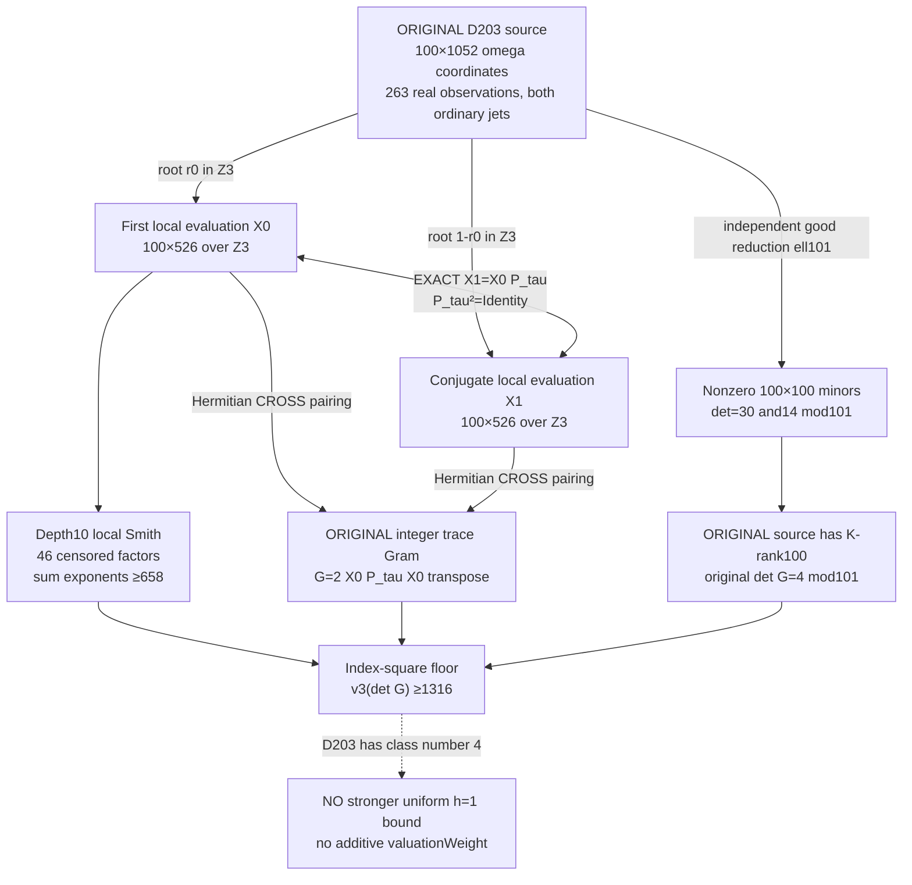

# Phase310 — Conjugate mirrors in the *entire original* arithmetic source

> **Two local embeddings, one involutive observation permutation, one genuine trace form.**
>
> The 3-adic source and Gram filtrations can be compared without replacing any original polynomial row, ordinary jet, evaluation point or integer trace metric. The result is a bounded exact arithmetic certificate at D203—not a uniform tenth-discriminant theorem.

**Draft:** stacked on [Phase309](../phase309/README.md). No changes to the reported \(322^4\) bound, the original field theorem, or the parent source code. All claims are typed and sourced to an actual test or an external algebraic theorem.

## What happens to the full 100-row source?

The original maximal order has \(\omega^2-\omega+51=0\). The original field is \(D=203\), \(\rho=24\), \(R=50,S=J=2\), 263 genuine maximal-order observations, 100 original monomial rows \(Z^rW^s\), and the **original ordinary** \(Z\)-jets \(j=0,1\). Original E has **100×1052** integer \(\omega\)-coordinates.

At split prime 3 the ring has two Hensel-compatible residue projections. The full observation ball is invariant under **actual algebraic conjugation** \(\tau(a,b)=(a+b,-b)\).

This Mermaid is only a projection of typed arithmetic maps; there is no actual model-internal geometry or quantum entanglement claimed.

## Phase310-A: conjugate mirror and nondegenerate first-level quotient

At \(p=3\), the two simple roots of \(t^2-t+51\) are \(0,1\). For any original source coefficient \(x=a+b\omega\),

    sigma_0(x)=a mod3,      sigma_1(x)=a+b mod3.

The actual Q263 observation conjugation gives an **involutive permutation** \(P_\tau\) on the 526 jet/point channels:

    X1 = X0 P_tau.

The unchanged original Hermitian trace Gram satisfies

    G mod3 = X0 X1^T + X1 X0^T
           = 2 X0 P_tau X0^T.

The exact source check reconstructs **all 105,200 original source coordinates** using an independent \(\omega\)-ring arithmetic implementation. It verifies **52,600 local conjugate coordinates** and **all 10,000 original Gram cells**.

The Frobenius ordinary-jet quotient

    F3[x]/((x³-x)²),  with (x³-x)²=x⁶+x⁴+x²,

has dimension6. The two original W monomials give a 12-element source basis. Every one of the 100 original rows reduces to that 12-row ordinary-jet span. All nine residue observation pairs occur in Q263; exact modular Gaussian checks show

    rank_F3(X0)=rank_F3(X1)=rank_F3(G)=12.

Hence both \(\ker(G\bmod3)\) and \(\ker(X0\bmod3)\) have dimension88, and their inclusion plus equal dimensions proves **the kernels coincide**. There is no extra first-level restricted-trace radical in the split embedding beyond the source evaluation kernel. This does not contradict the different p5 **inert** behavior.

## Phase310-B: *all* split-local Smith levels agree, but high valuations are censored

At precision \(3^{10}=59049\), actual Hensel roots are

    r0=28032,    r1=31018 = 1-r0 modulo 59049.

The exact 100×526 original evaluations are still related by the same actual observation permutation, so **all their local Smith factors are identical**, not merely their residue ranks.

The depth-10 source histogram of factors strictly BELOW ten is

    {0:12, 1:6, 3:6, 4:12, 6:6, 7:6, 8:6}.

**46 remaining factors have valuation at least ten**. This gives a proved finite-computation index lower bound

    sum_i b_i >= 658.

The original trace Gram's censored histogram at the same depth is

    {0:12, 2:5, 4:2, 6:3, 7:4, 8:9};

**65 factors have valuation at least ten**. Its direct independently censored determinant lower bound is 786, but this is substantially weaker than the index-square factorization when full rank is certified.

The implementation **never** converts a censored factor into an exact valuation. The modular DVR Smith elimination is checked on explicit diagonal cases, known determinant/rank examples, invertible row/column shears, rectangular units and censored zero matrices. Tests share authorship and are not human-independent verification.

## Phase310-C: independent nonzero minor and the first genuinely stronger floor

At the **different** good-reduction prime \(\ell=101\), \(t^2-t+51\) has simple roots 46,56. On the SAME original 100-row source, over each embedded residue field \(F_{101}\), explicit 100×100 pivot submatrix determinants are

    det(M_46)≡30 mod101,  det(M_56)≡14 mod101.

Both are nonzero. Furthermore the **original integer trace Gram** itself has

    det(G)≡4 mod101.

Thus the original evaluation has full row rank over the number field and the original Gram has nonzero integer determinant. This uses exact modular elimination; no floating-point rank criterion, fabricated observation or new Gram.

Over \(\mathbb Z_3\), Smith form of full-rank \(X0\) has diagonal \(3^{b_i}\). Since

    G=2 X0 P_tau X0^T

and the middle bilinear coefficient matrix after a Smith decomposition is integral, a standard DVR index-square argument implies

    v3(det G) >= 2 sum_i b_i >= 2*658 = **1316**.

This is a **lower bound**, NOT the exact 3-adic valuation. The exact answer could be strictly higher, and the residual trace valuation cannot be recovered until the censored Smith factors are resolved.

It is an exact-computation **fixed-field D203** result based on the unchanged original Gram and an independently nonzero minor. It does **not** improve the large hypothetical *class-number-one* field cutoff: \(D=203\) itself has class number4, and prime3 is split. The bound must not be added to any overlapping `valuationWeight` contribution.

## Formalization, audit and negative results

- `lean/TenthDiscriminant/Phase310SplitTrace.lean` kernel-checks the **commutative-ring split-root Hermitian trace polynomial identity only**. It does not formalize the whole D203 source, numerical Smith profile, class groups, or universal field theorem.
- Initial protocol: `PRE_REGISTERED_FULL_SOURCE_MIRROR.md`.
- Post-A, pre-code B protocol: `PRE_REGISTERED_SPLIT_DVR_FOLLOWUP.md`.
- Post-B, pre-code C protocol: `PRE_REGISTERED_FULL_RANK_CERTIFICATE.md`.
- Direct code: `full_source_split_mirror.py`, `split_dvr_smith.py`, `full_rank_certificate.py` and three hostile test suites.
- Focused CI in `.github/workflows/phase310-full-split-mirror.yml`; independent narrow Lean check in `phase310-lean-split-trace.yml`; repository whole-root Lean is a separate condition.

**[P-paper]** original-source conjugate mirror algebra, trace-cross pairing and standard DVR index-square inequality. **[M]** exact finite source, rank, Smith *censored* and good-prime minor witnesses under checked CI. **[S]** "two Worldlets" as vocabulary for different residue embeddings. **[H]** novel globally useful class-number-one obstruction or independent mathematical review. **[R]** "a local Picard ideal must increase the Gram p-valuation" and treating the filtered local losses as an already proven new bound.

**Stop:** Do not raise the dimensionality or declare adaptive cognition from these identities. The next experiment, if warranted, must either resolve the censored DVR depths with a different certificate or find a legitimate *uniform class-number-one* inequality that preserves the SAME original Gram and accounts for the existing local weights.
