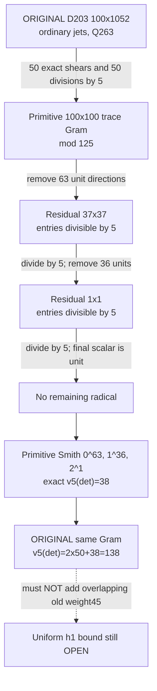

# Phase311 — the inert-prime tendril: source kernel **versus** trace radical

> Two distinct ways for arithmetic information to become invisible.
>
> **First:** an original polynomial row may vanish in the residue-field evaluation.
>
> **Second:** an evaluation direction may survive but pair to zero with the entire surviving image under the original Hermitian trace form.

The earlier split-prime duality (Phase310) did not prove these are the same mechanism at an **inert** prime. This experiment uses the genuine inert extension \(\mathbb F_{25}\), with the original source and original pairing, and tests both mechanisms separately.

This is a stacked, unmerged research draft on Phase310's merged research branch. No change to \`main\`, the original tenth-discriminant theorem, or the reported \(322^4\) cutoff.

## The carrier and two distinct kernels

For an imaginary quadratic maximal order \(O=\mathbb Z[\omega]\) with \(\omega^2-\omega+m=0\), take inert prime \(p=5\). Then \(k=O/5O\cong\mathbb F_{25}\), and conjugation equals the 5th-power Frobenius on \(k\).

Let \(E\) be the original polynomial ordinary-jet evaluation matrix over \(k\), and \(P_\tau\) the involutive permutation of the **actual** conjugation-stable observation columns (within each original ordinary-jet layer). Polynomial coefficients and the exactly divided integral source-normalized rows obey

\[
\overline E=EP_\tau.
\]

The original Hermitian trace Gram, reduced modulo 5, satisfies

\[
\boxed{G=\mathrm{Tr}_{k/\mathbb F_5}(E\overline E^{\,T})=2EP_\tau E^T.}
\]

Unlike a Euclidean same-side dot product, this is the restriction of the ambient conjugate bilinear pairing to the image of **the actual source map**.

If \(n\) is the number of original rows, \(r_E=\operatorname{rank}_{k}(E)\) and \(r_G=\operatorname{rank}_{\mathbb F_5}(G)\), then

\[
\dim\ker(E^T)=n-r_E,\qquad
\dim\ker G=n-r_G,\qquad
\boxed{\dim(\operatorname{rad}(\operatorname{im}E^T))=r_E-r_G.}
\]

The first quantity is a **source kernel**; the last is a **pairing radical on surviving evaluations**. They have different mathematical meanings and must never be added to a valuation formula without constructing the corresponding integral filtration.

## Three original-source controls

The CI independently computes \(\mathbb F_{25}\) ranks using genuine extension-field Gaussian elimination and realifies the full field map into an \(\mathbb F_5\)-matrix with twice the expected rank. It checks every trace-Gram cell against the actual conjugate point permutation, in both the original and primitive row frames.

| Field | Source | Expected original \((r_E,r_G)\) | Expected primitive \((r_E,r_G)\) | h1? |
|---|---|---|---|---|
| \(D=163\) | Matched \(\rho21,R40,S=J1\) | \((25,25)\) | \((40,40)\) | Yes |
| \(D=187\) | Same matched parameters | \((25,25)\) | \((40,40)\) | No |
| \(D=203\) | Native \(\rho24,R50,S=J2\), full Q263 | \((50,38)\) | \((100,63)\) | No |

The table records **previously observed parent predictions**, not new Phase311 measurements, until the new CI verifies them. Each primitive basis is obtained by exact original integral row shears and division by 5 on precisely 15 (D163/187) or 50 (D203) rows, not a global unimodular gauge.

If verified, D203's 50 integral /5 source divisions contribute an index-square factor of \(5^{100}\), while its primitive **37-dimensional pairing radical** contributes at least one further factor of 5 per radical dimension. Thus the SAME original Gram has the finite lower bound

\[
v_5(\det G_{203})\ge 2(50)+37=137.
\]

The prior exact Smith result \(v_5(\det G_{203})=138\) is a regression check, **not** deduced from the new rank computation. This 137 is not an independent additional contribution to the existing \`valuationWeight=45\` bound. In D163 and D187 the primitive pairing should be nondegenerate, yielding the already-known \(v_5(\det G)=30\).

The matched D163 and D187 profiles explicitly reject the assertion that **primitive trace nondegeneracy characterizes class-number-one**.

## Phase311-B — the one-dimensional secondary defect

The Phase311-A residue calculation gave rank 63 for the **primitive** 100-row Gram and therefore at least 37 positive 5-adic Smith exponents. This only guaranteed the original valuation lower bound 137. To resolve the difference with the earlier measured 138, we added **a separate preregistered derived-radical calculation**, not a new mathematical ontology.

Start with the original D203 evaluation at precision 5⁴=625 (necessary before **50 exact divisions** by 5), build the resulting primitive integral Gram modulo 5³=125, and perform *symmetric congruence* Schur elimination over the local rings:

The staged ranks are exactly **63, 36, 1**, with residual dimensions **100→37→1→0**. At the third stage no factor is censored. The original source's full **100×100 Gram factorization** is independently checked modulo 625, including the difference between integer-unimodular shears and non-unimodular /5 source divisions. A *separate* generic rectangular DVR Smith algorithm reproduces `{0:63,1:36,2:1}`; two nontrivial source congruences preserve the result. An off-diagonal-only symmetric unit block `[[0,1],[1,0]]` is a deliberate hostile test: a naive diagonal-only pivot algorithm would call it radical, but the correct odd-prime congruence exposes its units.

So the earlier reported original `v5(det G)=138` is now explained **without** a deep 5¹⁶ Smith computation: the finite staged calculation needs precision 5³ on the primitive Gram, after collecting the 5⁴ source digits required for exact division.

This is not a cohomological Bockstein, quantum tunnelling or a new global field bound; it is a genuine higher **DVR bilinear-form radical filtration**. Its proof obligations and stop rules were frozen in `PRE_REGISTERED_SECONDARY_RADICAL.md` after Phase311-A passed and *before* Phase311-B code.

## Types and provenance

- **Original D203 source:** unchanged Phase304 100×1052 coordinate evaluator, cross-checked against the independent Phase307 source evaluator; all 263 actual maximal-order observations, both original ordinary \(Z\)-jets.
- **Original D163/D187 source:** unchanged Phase304 matched half-integral norm-ball (converted exactly into maximal-order \(\omega\)-coordinates), with a different arithmetic power evaluator checking every original coefficient.
- **Finite field:** genuine inert \(\mathbb F_{25}\) (not \(\mathbb F_5^2\) treated as coordinatewise ring); field inverse identities and Frobenius conjugation checked.
- **Operator:** actual observation conjugation and Hermitian trace; \(EP_\tau E^T\) is not a Euclidean proxy.
- **Evidence:** [P-paper] conditional Hermitian radical decomposition, [M after CI] source ranks and countercontrols, [H] novel uniform h1 bound, [S] Worldlet vocabulary, [R] extra prime mass from adding overlapping valuations or a h1 diagnostic from the primitive radical.

## Reproduction and stop rule

Frozen prior-to-code plan: \`PRE_REGISTERED_INERT_TRACE_RADICAL.md\`. Source and hostile tests: \`inert_trace_radicals.py\` and \`test_inert_trace_radicals.py\`. CI: \`.github/workflows/phase311-inert-trace.yml\`.

A failed original-source entry, incorrect \(\mathbb F_{25}\) inverse, unequal direct/realified extension-field ranks, false conjugation permutation, or incorrect Gram trace forces correction rather than architectural escalation. The experiment cannot be merged into \`main\` or used to revise the original tenth-discriminant cutoff without an independently supported uniform field theorem.
