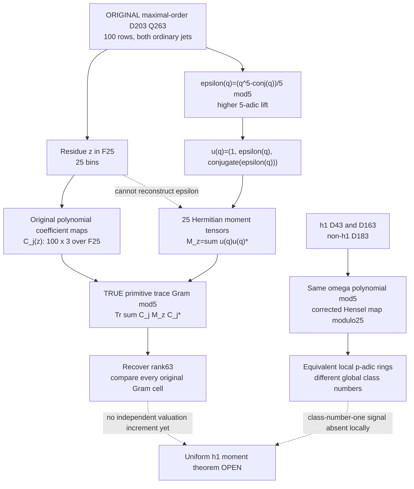

# Phase312 — Fermat-quotient tendrils through the ORIGINAL primitive source

> **Residues remember where an observation lands.**
>
> **The conjugate Fermat quotient remembers how it arrived.**
>
> Neither remembers the field's class number without an additional, genuinely global theorem.

Phase312 is a stacked research DRAFT on [Phase311](../phase311/README.md). It does not modify the original integer-order source, maximal-order source, fixed D203 Gram, existing valuationWeight, or reported 322⁴ discriminant cutoff. Its purpose is to separate one valuable higher-lift reconstruction from an attractive—but presently unproved—class-number-one inference.

## Three genuinely typed operations

The lines represent actual algebraic maps and missing implications, not model intelligence or physical quantum links.

## 1. Classical unramified Fermat quotient, corrected lift

In \(\mathcal O_D=\mathbb Z[\omega]\), \(\omega^2-\omega+m=0\), \(m=(D+1)/4\), at inert 5 let

\[
\varepsilon(z)=\frac{z^5-\overline z}{5}\bmod5
\quad\in\mathcal O_D/5\mathcal O_D\cong\mathbb F_{25}.
\]

Conjugation reduces to 5th-power Frobenius. This is integral; as a map it is **not additive**. The exact identities, checked with independently computed quadratic coordinate arithmetic, are

\[
\varepsilon(xy)=\varepsilon(x)\overline y+\overline x\varepsilon(y),
\]

\[
\varepsilon(x+y)=\varepsilon(x)+\varepsilon(y)
+\sum_{i=1}^{4}\frac{\binom5i}{5}x^iy^{5-i}\pmod5.
\]

Moreover

\[
\frac{z^{25}-z}{5}\equiv\overline{\varepsilon(z)}\pmod5.
\]

These are instances of classical Frobenius-lift / \(p\)-derivation machinery (see [SMF notes on arithmetic differential equations](https://smf.emath.fr/sites/default/files/2026-04/smf_sem-cong_27_13-24__sample.pdf)); no mathematical novelty is asserted.

## 2. Entire D203 primitive source, including the forgotten ordinary derivative

For the **actual original** R50/S=J2 rho24/Q263 D203 source, after the previous integer-unimodular shears and 50 exact /5 divisions, there are three kinds of source row.

The 50 unchanged rows have their usual original polynomial and ordinary Z-derivative values. The 45 divided Frobenius rows satisfy

\[
F_r=\frac{Z^r-Z^{r-5}W}{5},\quad r=5,\ldots,49,
\]

\[
F_r(z)^{(0)}=z^{r-5}\varepsilon(z),\qquad
F_r(z)^{(1)}=z^{r-1}+(r-5)z^{r-6}\varepsilon(z).
\]

The 5 divided higher Hermite rows satisfy

\[
K_a=\frac{Z^{45+a}W-2Z^{26+a}+Z^{2+a}}5,\quad a=0,\ldots,4,
\]

\[
K_a(z)^{(0)}=-z^{45+a}\varepsilon(z),
\]

\[
K_a(z)^{(1)}
=-z^{49+a}-a z^{44+a}\varepsilon(z)
-2z^a\overline{\varepsilon(z)}.
\]

All displayed equalities are modulo5, with **ordinary Z-jets holding W fixed**. Differentiating the fictitious constraint W=Z⁵ would give the wrong original jet; a hostile test guards against it.

Every primitive row/jet value is therefore affine-linear in \(u(z)=(1,\varepsilon(z),\overline{\varepsilon(z)})\). The code verifies all original 100×1052 omega coordinates against the frozen original evaluator and its exact /5 integer saturation.

## 3. The precise sufficient statistics are 3×3 Hermitian moments

For each residue \(z_0\in\mathbb F_{25}\), keep the FULL tensor

\[
M_{z_0}=
\sum_{\substack{z\in Q\\z\equiv z_0\bmod5}}
u(z)\,\overline{u(z)}^{\,T}.
\]

This holds precisely the zeroth, first and **second** Fermat moments: count, \(\sum\varepsilon\), \(\sum\varepsilon^2\), \(\sum\varepsilon\overline\varepsilon\), and conjugates. The previous informal suggestion of only the count, first moment and \(\sum\varepsilon\overline\varepsilon\) was insufficient to reconstruct arbitrary pairings.

If \(C_j(z_0)\) gives the three affine coefficients of the ORIGINAL primitive row/jet basis, then

\[
G_{\rm primitive}\bmod5
=\operatorname{Tr}_{\mathbb F_{25}/\mathbb F_5}
\sum_{z_0,j} C_j(z_0)M_{z_0}\overline{C_j(z_0)}^{\,T}.
\]

At the actual D203 source, observations \(1\) and \(6\) have the SAME residue but Fermat quotients \(0\) and \(4\). The primitive row \(F_5\) distinguishes them. This proves that raw residue counts alone cannot recover the primitive source. It does not claim such moments are enough for all higher 5-adic Smith layers: the formula reconstructs the primitive Gram ONLY mod5.

## 4. Global class number one does not follow from a local chart

Use matched rho21/R40/J1, explicitly **NOT** native field-level sources, on

| Discriminant | Standard class number | m | m modulo5 |
|---:|---:|---:|---:|
| D43 | 1 | 11 | 1 |
| D163 | 1 | 41 | 1 |
| D183 | 8 | 46 | 1 |

All three are inert at 5 and have the same \(\mathbb F_{25}\) omega presentation. Each field has its own actual norm-ball and its own higher lift.

To compare higher 5-adic fields, the naked identification \(\omega_D\mapsto\omega_E\) is **incorrect** modulo25. The corrected ring isomorphism is

\[
\omega_D\longmapsto\omega_E+5t,\qquad
t=\frac{m_E-m_D}{5}(2\omega_E-1)^{-1}\bmod5.
\]

This map respects the defining quadratic relation, conjugation, multiplication and the Fermat quotient. Thus a discrepancy from ignoring the correction is a **coordinate artifact**, not a newly discovered global h1 invariant. The matched observation sets differ because their global norms differ; no norm-ball equivalence is claimed.

A complete reduced-form enumeration (using the classical forms-to-ideal-class theorem) gives h=1,1,8. D183 also has a ramified ideal of norm3 with no possible principal generator of norm3, proving h≠1 independently. [Heegner class-number-one background](https://mathworld.wolfram.com/GausssClassNumberProblem.html).

## 5. Ray classes are a possible global carrier, not an automatic determinant gain

For D>3, global units are ±1. At inert5, local unit counts are

\[
|(\mathcal O/5)^\times|=24,\qquad
|(\mathcal O/25)^\times|=600.
\]

The STANDARD ray-class exact sequence then yields \(|\mathrm{Cl}_{5}(K)|=12h_K\), \(|\mathrm{Cl}_{25}(K)|=300h_K\). In particular, even when \(h_K=1\), the ray groups remain nontrivial. This requires the classical exact sequence, not merely a computer count; see [MIT 18.785 lecture notes on ray classes](https://math.mit.edu/classes/18.785/2015fa/LectureNotes20.pdf).

Its residue-class characters live naturally on ideals coprime to the modulus. Nonunits and divisible observations require a separate valuation stratum. Character orthogonality can organize **bounded** principal-element sums, but the ray-class group cardinality alone forces no specific congruence for these finite sums.

## 6. What would actually move the tenth-discriminant bound?

The current Lean theorem controls `integerRectangularTraceGram` with the existing source and an exponent \(2\operatorname{valuationWeight}(R,S,p)\), under the class-number-one assumption and small-prime inertness. The D203 primitive source here is a separate maximal-order realization. Its exact v5=138 is an already verified **fixed non-h1 field** computation, not a uniform improvement.

A worthwhile field theorem must establish, for the SAME original Gram and SAME admissible source, a non-overlapping *extra* integral invariant. In outline:

\[
U G U^T=D_5 H D_5,\qquad
v_5(\det G)=2\sum_i e_i+v_5(\det H),
\]

with a field-uniform h1-implied lower bound on the remaining \(v_5(\det H)\), while proving it is NOT already included in the inherited `valuationWeight`. No such theorem currently follows from the residue moments or ray classes alone.

**Evidence contract:** [P-paper] exact algebraic identities and standard field/moment linear algebra, [M once CI passes] fixed-source reconstructions and controls, [H] class-one ray moment congruences forcing independent Gram mass, [R] naive local ring coordinate comparison and residue-only recovery of primitive Gram. The narrow Lean identities prove fifth-power polynomial equalities, not F25 source theorems.
