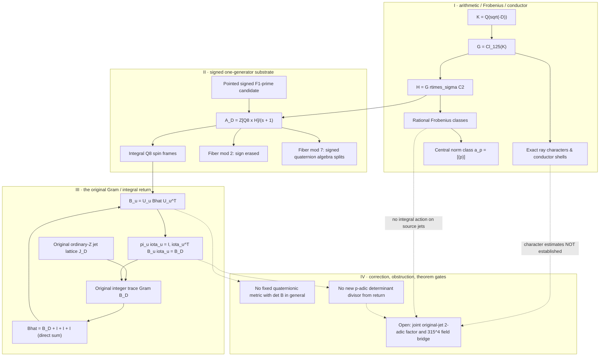

# Phase328 · The Integral-Return Tapestry

**One generator · plural fibers · moving moving frames · exact return**

A tapestry is not a bigger scalar, nor a new field of characteristic
one. It is an incidence structure of **typed mathematical objects,
morphisms, invariants, and explicit obstructions**. This package
weaves the ray-class/Frobenius and quaternionic lines together without
claiming that a finite character sum proves the 315^4 bound.

## The living weave



The diagram is intentionally a **typed partial tapestry**, not a
commuting square across *all* arrows. The redirection from source
Gram to source Gram through a moving frame is exact; the external
Frobenius-to-original-jet bridge is still open.

## 1. The completed integral-return square

Let `J_D = Z^N` be the row module of the exact original ordinary-Z
integer trace Gram `B_D`. Set

```math
\widehat J_D = J_D^{\oplus4},\qquad
\widehat B_D = B_D\oplus I_N\oplus I_N\oplus I_N.
```

For a signed quaternion frame `u in Q8`, let `U_u` act by left
quaternionic multiplication on the four copies. It is an integral
signed permutation, with `U_u^T U_u = I` and `det U_u=1`.

Writing `iota_0:J_D -> widehat J_D` for the scalar-component
embedding and `pi_0` for its integer projection, transport the
*metric and the maps together*:

```math
B_u=U_u\widehat B_DU_u^T,\qquad
\iota_u=U_u\iota_0,\qquad
\pi_u=\pi_0U_u^T.
```

Then the actual identities, valid for **every** integer source Gram,
are

```math
\boxed{\pi_u\iota_u=I_N},\qquad
\boxed{\iota_u^TB_u\iota_u=B_D},\qquad
\boxed{\det(B_u)=\det(B_D)}.
```

The proof is substitution and `U_u^TU_u=I`; no class number
hypothesis or unproved analytic estimate is used.

A **moving moving frame** is a succession of frames. With
`U_{uv}=U_uU_v`, the metrics and inclusion maps obey

```math
B_{uv}=U_u B_v U_u^T,\quad
\iota_{uv}=U_u\iota_v,\quad
\pi_{uv}=\pi_v U_u^T.
```

This closes the discrete integral covariance square. In particular
`u=-1` acts as a sign on the transported *spinor inclusion* but
does not change the metric; the adjoint frame forgets that sign.
In characteristic 2 the inclusion sign itself disappears.

**Very important:** this is a return of Gram matrices and integral
lattice coordinates. It is not a new action of the ray class group on
the original ordinary-Z differentiation operator. It does not change
the definition of `integerDerivativeRow` or `integerPairTrace`
in `lean/TenthDiscriminant/IntegerTraceGram.lean`.

## 2. The adversarial opposite: a fixed metric forces a fourth power

There are two constructions that must never be silently identified.

| Geometry | Quaternion action on fixed metric | Determinant |
|---|---|---|
| `B + I + I + I` | generally **not** an isometry | `det B` |
| `B + B + B + B` | Q8 acts as an isometry | `(det B)^4` |

For the one-dimensional source `B=[2]`, the first stabilized
metric is `diag(2,1,1,1)`. Left multiplication by `i` moves
the position of the coefficient 2: it is not a fixed-metric
isometry, but the determinant remains 2 under metric transport.

The second metric `diag(2,2,2,2)` is Q8-invariant, but has
determinant 16. Concluding that `16 | det B` from the second
construction would be false. This is the permanent **no-fake-prime-
valuation** control.

There is a further rank obstruction, already recorded in Phase327:
the rational Hamilton quaternion division algebra has only modules
of rational dimension divisible by four. Some admissible original
`RS` jet spaces have rank `2 mod 4`. Stabilization creates an
external module where the Q8 representation acts; it does not
manufacture an action on that unchanged source space.

Continuous real quaternion frames could provide smooth paths,
but an integer matrix group is discrete: no nonconstant
continuous path through `GL_(4N)(Z)` exists. Our integral frame
test uses the discrete Q8 subgroup; the earlier 360x360 harness
tested *half-turn pulse counts*, not every continuous angle.

## 3. How the other threads enter without loss of type

The external tensor factor is the signed algebra

```math
A_D=\mathbb Z[Q_8\times H_D]/(s+1).
```

The regular A-module is generated by its identity element
`Omega_D=1`. This is one **cyclic generator of the algebra as its
own module**, not one generator for `J_D^{oplus4}` when
`rank(J_D)>1`.

The arithmetic group `H_D` is not replaced by the toy
`C4 x C6 rtimes C2` in `tapestry.py`. That toy tests the
*typed semidirect multiplication law* and the Frobenius-square
identity; the actual field-dependent class data remain in
Phases321–325.

Under the arithmetic Artin convention, for a rational inert prime
`p` coprime to `5D`, a rational Frobenius lift is `g sigma`
with `(g sigma)^2=g sigma(g)=[(p)]`. A nontrivial
norm twist is preserved by the finite semidirect multiplication,
while quaternionic and H actions commute as **external tensor
factors**. Commuting tensor factors alone do not define an
arithmetic action on the original polynomial jet module.

The reduction maps `A_D -> A_D tensor F2` and
`A_D -> A_D tensor F7` commute with integral multiplication,
but the first loses signed distinctions and the second
does not lift arbitrary `M2(F7)` modules back to rational
Hamilton quaternion modules. The loss is part of the tapestry,
not swept into a scalar confidence value.

## 4. Executable loom and independently named gates

- `stabilized_return.py`: exact integral Hamilton signed
  permutation frames, moving-Gram transport, determinant, return.
- `test_stabilized_return.py`: literal small original integer
  trace-Gram cases (ordinary Z derivative, factor-two pairing),
  Q8 covariance, randomized integral Gram, no-gain negative controls.
- `tapestry.py`: exact semidirect toy norm/Frobenius square,
  commuting external tensor factors, typed node/edge catalogue,
  explicit unresolved theorem gates.
- `test_tapestry.py`: checks exact toy group multiplication,
  class-square centrality, tensor commuting, source return and
  prevents finite tests from upgrading the field-uniform bound.
- `lean/TenthDiscriminant/Phase328StabilizedSourceReturn.lean`:
  Lean-verified exact entrywise/full-matrix original-Gram return
  and identity auxiliary blocks.
- `lean/TenthDiscriminant/Phase328MovingFrameCovariance.lean`:
  Lean-verified **generic** matrix theorems for a covariant
  retraction, metric recovery and determinant preservation under
  explicitly assumed orthogonality, source compatibility and
  determinant-one hypotheses. The check reports no sorryAx.
  The concrete all-Q8 matrix instances, plus
  `det(B + I + I + I)=det B`, are finite-tested and have
  elementary proofs; the single composed **concrete** Lean
  theorem from all these hypotheses to the original determinant
  remains a separate formalization target.

The proposed `315^4` bound still requires, independently:

1. A combined same-gram **original-ordinary-Z jet** 2-adic
   divisibility proof, not separate factors multiplied blindly.
2. The finite odd-prime logarithmic lower transported to that same
   exact Gram and discriminant domain.
3. The analytic upper and actual-field synthesis on that domain,
   including all strict positivity and original-source conditions.

The executable `eligible_to_claim_315` gate only detects explicitly
recorded prerequisite flags; it cannot verify that a user-supplied
flag corresponds to an independent mathematical proof.

## Evidence classification

- **P (algebraic proof):** identities for
  `pi_u iota_u`, `iota_u^T B_u iota_u`,
  determinant under unimodular congruence;
  external tensor multiplication laws.
- **M (exact finite experiment):** bounded source-Gram cases,
  all Q8 frames, random small integer Grams, characteristic
  reduction and semidirect toy tests, with CI provenance.
- **H (open):** nontrivial integral ray-group action on the
  unchanged ordinary-Z jets, descent/gluing of the complete
  one-generator field ecology, and a new discriminant endpoint.
- **S (mathematical seed):** a signed F1-prime "one-element field"
  interpreted as a pointed-monoid/algebra generation principle,
  not a conventional field with characteristic one.
- **R (blocked inference):** fixed-isometry versus moving-metric
  confusion; det(B)^4 as additional det(B) divisibility;
  characteristic-2 nilpotence as new integer valuation;
  finite Frobenius classes as a global prime-distribution theorem.

**Smallest surviving theorem:** a covariantly moving integral
quaternionic *stabilization* returns exactly to the original
integer Gram and determinant, while retaining the spin sign in
the transported inclusion (until reduction modulo 2).

**Smallest missing arithmetic bridge:** an integral operator
on the unchanged original ordinary-Z jets whose valuation
survives that return and is not simply an effect of the
auxiliary quaternionic copies.

The tapestry is therefore **constructed locally**, with a
genuine closed return square. Its universal gluing and its
discriminant-strengthening implications remain open.
