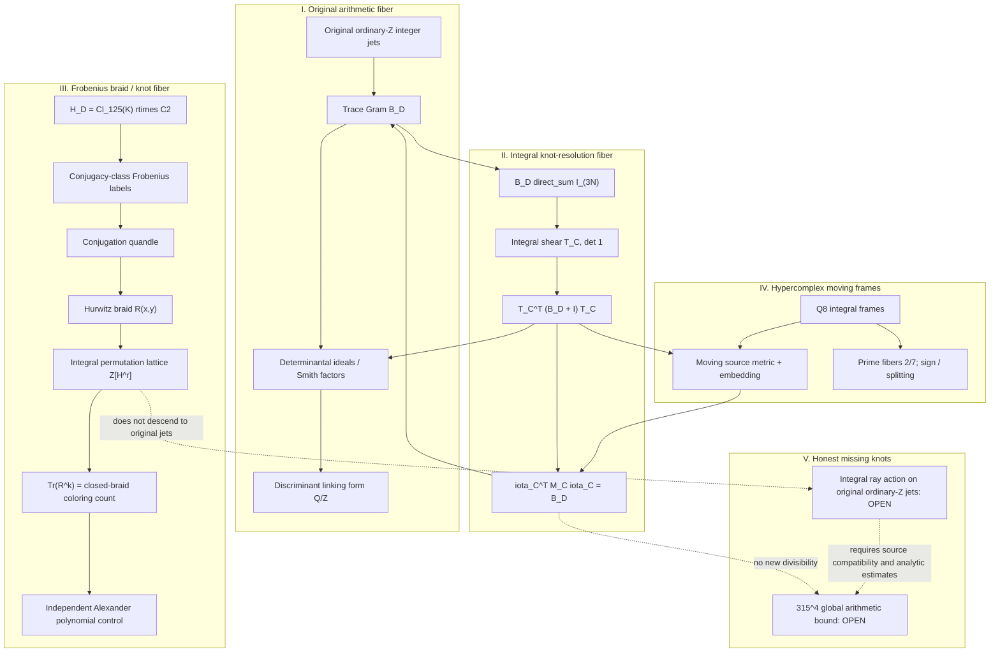

# Phase329 — Knot Resolution as an Arithmetic Lift

> Knot ≠ mistake. Unknotting is an equivalence problem. An invariant
> tells us exactly which transformations were legitimate.

**Scope.** Continue Phase328 without Work and without altering `main`.
Lift two well-developed mathematical calculi into the existing tapestry:

1. **Kirby/handle-slide analogue:** reversible *integral congruences*
   of the original integer trace Gram with auxiliary unit blocks.
2. **Reidemeister/Hurwitz braid action:** conjugacy-preserving
   transport of group-valued strands, suited to Frobenius conjugacy
   labels, with exact finite quandle-coloring and Alexander controls.

Their common abstraction is a *typed reversible presentation change*;
the two fibers are not identified without a genuine integral
source-jet operator. There is no new discriminant endpoint here.

## The woven diagram



## I. Exact integral unknotting theorem

Let `B in Mat_n(Z)` be the **unchanged** source integer Gram,
`C in Mat_(m x n)(Z)` any coupling, `I=I_m`, and set

```math
T_C=\begin{pmatrix}I_n&0\\C&I_m\end{pmatrix},
\quad
T_C^{-1}=\begin{pmatrix}I_n&0\\-C&I_m\end{pmatrix},
\quad\det T_C=1.
```

The presentation after a handle-slide-style coupling is

```math
M_C=T_C^T(B\oplus I_m)T_C
 = \begin{pmatrix}
 B+C^TC&C^T\\
 C&I_m
 \end{pmatrix}.
```

The source-embedding is `iota_C=(I_n;-C)`, with return
`pi_C=(I_n,0)`. By direct integral matrix algebra,

```math
\boxed{\pi_C\iota_C=I_n},\quad
\boxed{\iota_C^TM_C\iota_C=B},\quad
\boxed{\det(M_C)=\det(B)}.
```

The entire identity holds for every integer matrix B, including
singular and indefinite ones (the linking form below requires
nonzero determinant). For `m=3n`, this is the exact rank-4n
Phase328 stabilization, now with genuine off-diagonal integral
couplings. Each quaternionic signed-permutation frame `U_u`
moves **both metric and source maps**:

```math
M_{u,C}=U_uM_CU_u^T,\quad
\iota_{u,C}=U_u\iota_C,\quad
\pi_{u,C}=\pi_CU_u^T.
```

All three return identities remain exact. The named source
`B_D` is built using the literal integer-pair ordinary-Z derivative
from `lean/TenthDiscriminant/IntegerTraceGram.lean`. Our
source-dependent `C(B)` is a *computational probe*, not a
number-theoretic factor extracted from Frobenius or ray classes.

This has the same algebraic form as the integral row-and-column
operations arising from handle slides of framed links, but does
**not** construct an actual 4-manifold or prove Kirby equivalence
of a chosen topological framed-link diagram.

Reference: R. Kirby, *A calculus for framed links in S^3*;
algebraic handle slides / linking forms are standard:
https://encyclopediaofmath.org/index.php?title=Kirby_calculus

## II. Preserve the arithmetic "knots" that matter

For a nonsingular integral Gram B, define its finite
**discriminant group**

```math
A_B=\mathbb Z^n/B\mathbb Z^n
```

and its rational linking pairing

```math
\lambda_B(\bar x,\bar y)=x^TB^{-1}y\pmod{\mathbb Z}.
```

A shear congruence induces the explicit isomorphism

```math
A_{M_C}\xrightarrow{\ \sim\ }A_{B\oplus I_m}
\simeq A_B,\qquad [v]\mapsto[T_C^{-T}v].
```

It preserves the linking form and every prime-primary
discriminant-group invariant. The order of `A_B` is
`|det B|`. For example,

```math
B=\begin{pmatrix}14&7\\7&14\end{pmatrix},\quad
\det B=147,\quad A_B\simeq\mathbb Z/7\oplus\mathbb Z/21.
```

For **any** integral C of size 6x2, the coupled rank-8
form has Smith factors

```text
1, 1, 1, 1, 1, 1, 7, 21.
```

The linking form on standard generators satisfies
`lambda_B(e1,e1)=2/21` and
`lambda_B(e1,e2)=20/21 (mod 1)`, preserved under
the exact inverse-transpose transport. These are
computed using rational fractions and determinantal-divisor
gcds, not floating estimates.

**Arithmetic kill condition:** An integral gauge/handle-slide
cannot increase `v_p(det B)`; a claimed *new* p-adic gain must
produce a new source-jet congruence or a novel estimate on the
actual original Gram, not a different basis presentation.
Finite knot colorings likewise do not control global prime
distribution.

## III. Frobenius group-valued braid transport

For any group `H`, define the conjugation quandle

```math
x\triangleright y=y^{-1}xy.
```

Its idempotency, inverse right action and distributivity
are the algebraic Reidemeister I/II/III identities. A
positive Hurwitz generator acts on a pair of strands as

```math
R(x,y)=(xyx^{-1},x),\qquad
R^{-1}(u,v)=(v,v^{-1}uv).
```

The move preserves `xy` and the conjugacy classes of the two
strands up to permutation. The braid relation
`R_1R_2R_1=R_2R_1R_2` holds on triples. This is meaningful
for rational Frobenius elements because conjugacy class, not
one chosen representative, is the invariant of an unramified
prime. The Phase328 48-element semidirect group is used here
as a *toy*. It is not the actual 15,000/30,000/60,000-element
Phase325 Galois group.

### First genuinely integral braid representation

The Hurwitz move is a permutation of `H^2`. Extend it by
linearity to the free **integer** module

```math
\mathcal V_H=\mathbb Z[H^2].
```

Then `R\in GL_(|H|^2)(Z)` as a permutation matrix. Its
signed determinant is `+1` or `-1`. For any odd `k`,

```math
\operatorname{Tr}(R^k)=
\#\{(x,y)\in H^2:R^k(x,y)=(x,y)\},
```

the group-conjugation quandle coloring count of the
two-strand braid closure `sigma_1^k`.

Exact cycle data from the experiment:

| Finite group | Rank | Permutation cycle structure | Determinant |
|---|---:|---|---:|
| S3 | 36 | 6(1), 6(2), 2(3), 3(4) | -1 |
| Toy H48 | 2304 | 48(1), 696(2), 216(4) | +1 |

The S3 coloring detects the trefoil (12 colorings)
versus unknot (6). The toy H48 coloring does *not*:
48 for both. This matched failure is important.
The actual Hamilton quaternion and finite ray-class
lattices are not thereby transformed into the same module.

The independent Alexander polynomial detects the trefoil:

```math
\Delta_{\operatorname{unknot}}(t)=1,\qquad
\Delta_{\operatorname{trefoil}}(t)=t^2-t+1.
```

For the positive odd two-strand braid closure, we use only
the classical reduced-Burau identity
`(1+t^k)/(1+t)=sum_(j=0)^(k-1)(-t)^j`.
This does not imply the Alexander polynomial is a complete
knot invariant either.

References:
- L. H. Kauffman, *Knots*, on quandle colorings and Reidemeister
  moves: https://homepages.math.uic.edu/~kauffman/Tots/Knots.htm
- Hurwitz braid group action:
  https://doi.org/10.1515/jgth-2016-0025
- On knot Alexander invariants:
  https://homepages.math.uic.edu/~kauffman/Tots/Knots.htm

## IV. The theorem boundary: lift versus arithmetic gain

The new braid action is an integral **unimodular**
representation on the external free module `Z[H^2]`.
It is *not* a sourced representation on the original
`J_D=Z^(R(D)S(D))` whose ordinary-Z derivatives define B_D.

A direct universal `H_D` / quaternion action on J_D is
not assumed, and the previous rank obstruction remains.
The chosen Gram may be stabilized and moved without
changing the source determinant, but this alone neither
increases p-adic mass nor provides a uniform
character-average bound.

The next meaningful arithmetic target is the original
Gram's **p-adic determinantal filtration**:
`I_k(B_D)`, the ideals generated by its `k x k` minors.
These ideals survive unimodular equivalences. To
improve the discriminant bound one must find a
new original-jet constraint on their valuations,
or obtain independently justified global prime
statistics; braid transport does neither by itself.

### Evidence and files

- **P (mathematical identities):** integral shear/coupled
  form and exact retraction; conjugation-quandle laws,
  braid product, free-module permutation action.
- **M (CI finite):** exhaustive H48 triple braid test,
  actual small source-Gram determinant and Smith factors,
  inverse-transpose rational linking form,
  S3/H48 braid traces, negative controls.
- **H (open):** connecting the ray group braid action
  integrally to original ordinary-Z jets; p-adic gain;
  a global 315^4 field theorem.
- **R (ruled out):** "all knots are unknotted by Gram
  congruence", "larger coloring group always detects more",
  "stabilization adds arithmetic prime divisibility".

Python:
`integral_unknot.py`, `braid_frobenius.py`,
`arithmetic_knot_invariants.py` and their tests.

Lean:
`lean/TenthDiscriminant/Phase329IntegralKnotLift.lean`
with generic integral-return, determinant and
group-conjugation quandle statements; passing CI
must precede a P designation for that formal artifact.

## Next experiment

A source-faithful link is a **typed tangle**, not merely
a colorful crossing:

```text
genuine ray-class Frobenius/braid data
                 |  unknown integral intertwiner
                 v
       original ordinary-Z jet module
                 |  original trace Gram
                 v
      p-adic determinantal filtration
                 |  independently proved inequality
                 v
            field bound
```

Find that intertwiner or prove its impossibility under
a minimal naturality hypothesis. Until then the two
threads share a valid mathematical tapestry but
not one source-compatible arithmetic proof.
