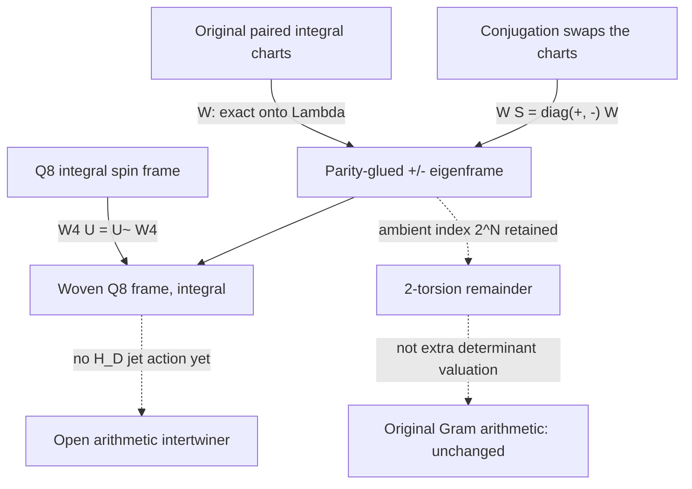

# Phase330 — The half-turn that cannot return integrally

**Conjugate-chart descent / cyclic cohomology / characteristic fibers**

This phase continues the Phase329 arithmetic knot programme on its
single research branch. It identifies an **exact necessary obstruction**
to a symmetrical integral return from paired conjugate charts.
It does NOT prove a no-go for every possible, nontrivially acted-on
source module, and it does not prove or improve the 315^4 field bound.

## Mathematical target

Fix a free nonzero integral chart module `J=Z^N`.
Let the conjugation involution exchange two **isomorphic abstract**
charts: `sigma(x,y)=(y,x)` on `V=J direct_sum J`.
Let the target `J` carry the **trivial** involution. The
diagonal embedding `Delta(x)=(x,x)` is equivariant.

Seek an additive, integral, equivariant left inverse
`P:V->J` satisfying

```math
P\circ\Delta=\mathrm{id}_J,\qquad
P\circ\sigma=P.
```

These equations **force division by two**. By additivity,
`P(x,x)=P(x,0)+P(0,x)`, and equivariance gives
`P(x,0)=P(0,x)`. Therefore

```math
x=2P(x,0).
```

A standard integral basis vector has an odd coordinate, so this
is impossible for `J=Z^N`, `N>0`. The theorem is independent
of B, D, J's rank and any character-sum estimate.

Over a commutative unital ring R and `J=R^N` with `N>0`,
a **linear** equivariant retraction exists iff `2` is a unit:
if it exists, evaluation on a basis vector yields `2a=1`;
conversely `P(x,y)=2^{-1}(x+y)` works.

| Coefficients | 2 invertible | Symmetric linear return |
|---|---|---|
| Z | No | Impossible |
| Q / Z[1/2] | Yes | (x+y)/2 |
| F2 | No | Impossible |
| F7 | Yes | 4(x+y) |
| Z/14 | No | Impossible (F2 component blocks CRT descent) |

This **does not** contradict the already verified Phase328
non-equivariant integral retraction `P(x,y)=x`. It changes
which relationship is required to commute.

## Why this is a genuine cohomological knot

Let `S` denote chart exchange, and let

```math
N=1+S,\qquad D=1-S.
```

Over Z,

```math
N^2=2N,\quad D^2=2D,\quad ND=DN=0.
```

Thus `N` and `D` are **not integral idempotent
projectors**. Dividing by 2 yields the usual plus and minus
character idempotents, but requires leaving the integral
coefficient ring. Modulo 2, `N=D` and `N^2=0`, although
`N != 0`. Modulo 7, `4N` and `4D` become complementary
idempotent projectors.

The extension

```math
0\to\mathbb Z_{\mathrm{triv}}
\xrightarrow{\Delta}\mathbb Z[C_2]
\xrightarrow{(x,y)\mapsto x-y}\mathbb Z_{\mathrm{sign}}
\to0
```

splits as *abelian groups* but not as `Z[C2]` modules.
The cyclic group cohomology of the sign module is

```math
H^1(C_2,\mathbb Z_{\mathrm{sign}})
=\ker(1+\sigma)/\mathrm{im}(\sigma-1)
\simeq\mathbb Z/2\mathbb Z.
```

This is a **known theorem of cyclic group cohomology**, not a
new invention. The source-exact nonsplitting is proved
directly, and the bounded tests verify its finite manifestations.
The cohomology identification is mathematical background, not
a fully Lean-formalized H1 quotient.

Primary mathematical reference:
- J. S. Milne, *Class Field Theory*, cyclic-group cohomology and
  norm maps: https://www.math.mcgill.ca/darmon/courses/18-19/cft/refs/milne.pdf

## Consequence for the moving moving frame

Two previously distinct requirements are now separated:

1. **Integral retraction**: the original source is recovered,
   possibly after a moving-frame change. Phase328/329 proves this
   for its explicit integral source embeddings.
2. **Conjugation-equivariant integral descent to one trivially
   acted-on chart**: the return commutes with chart exchange.
   This Phase330 model proves that a diagonal descent of two
   identical nonzero free charts **cannot** satisfy both.

The actual source's chart types matter. Its original rectangle
is `R x S`, and its conjugate has dimensions `S x R`;
`partial_Z` and `partial_W` are exchanged by conjugation,
but do not agree as operators on the original chart. Even where
the underlying ranks match, an identification must preserve the
correct derivative and evaluation conventions.

The theorem is therefore a **conditional structural barrier**,
not an assertion that every mathematically reasonable
`H_D` action on original jets is impossible. A target carrying
a nontrivial involution, a larger module, or a partial domain
could admit a different bridge. Such a bridge must be separately
constructed and verified.

### Contact with p-adic Gram valuations

For the original integer source Gram `B_D`, the duplicated
metric `B_D direct_sum B_D` pulls back along the diagonal to

```math
\Delta^T(B_D\oplus B_D)\Delta=2B_D.
```

This **does not show** `2B_D` divides `B_D` or improve the
2-adic valuation of the original determinant. In fact,
`det(2B_D)=2^N det(B_D)`: the extra powers are created by
duplicating the chart. The symmetric return would require
`1/2`, precisely the rational coefficient that the
source-prime-2 arithmetic cannot silently introduce.

Also: braid Hurwitz transport `(x,y)->(xyx^-1,x)`
is generally **not** the simple swap `(x,y)->(y,x)` for a
nonabelian group. The C2 no-go concerns chart conjugation,
not arbitrary Frobenius braid actions.

## A constructive untangling: parity-glued integral eigenframes

The no-go above does **not** require discarding symmetry. It says
that symmetry cannot be projected to *one integral trivial chart*.
Keep the two eigendirections instead, **with their gluing data**.

Define

```math
W=\begin{pmatrix}I&I\\I&-I\end{pmatrix},\quad
W(x,y)=(u,v)=(x+y,x-y).
```

The matrix W has determinant `(-2)^N` and satisfies
`W^2=2I`. It is therefore not an integral unimodular
coordinate change on the entire ambient `Z^(2N)`.
But its image is the precise parity-constrained sublattice

```math
\Lambda=\{(u,v)\in\mathbb Z^N\oplus\mathbb Z^N :
  u\equiv v\pmod 2\}.
```

And `W:Z^(2N)->Lambda` **is an integral isomorphism**:
if `u≡v mod 2`, then `x=(u+v)/2` and `y=(u-v)/2`
are integers. Conversely every woven pair has equal parity.
The index of Lambda in ambient `Z^(2N)` is `2^N`;
the quotient is exactly `(Z/2)^N`.

The chart exchange **diagonalizes without losing integrality**:

```math
W\begin{pmatrix}0&I\\I&0\end{pmatrix}
=\begin{pmatrix}I&0\\0&-I\end{pmatrix}W.
```

The equal-parity condition is the thread that prevents
the two eigenchannels from being mistaken for independent
unrestricted integer lattices.

### Exact metric and remainder accounting

For the duplicated original source bilinear form `B⊕B`,
the transported form on Lambda is

```math
\left\langle(u,v),(u',v')\right\rangle_\Lambda
=\frac{u^TB u'+v^TB v'}2.
```

This is **integer-valued on Lambda** even when the ambient
formula has half-integral coefficients. The Gram of
Lambda with respect to the W-transferred integer basis
is exactly `B⊕B`. The apparent ambient denominator
`2^(2N)` in its determinant cancels with the square
of the parity lattice's index `(2^N)^2`.
No new divisor of det B has appeared.

### The quaternionic moving-frame bridge

On the Phase328 four-copy lattice `J^4`, use two
weaves `W_4=diag(W,W)` on the quaternion-coordinate
pairs `(1,i)` and `(j,k)`. Every `u∈Q8` has an
**integral orthogonal** conjugate representation

```math
\widetilde U_u=W_4U_uW_4^{-1},\qquad
\widetilde U_uW_4=W_4U_u.
```

Despite the formal rational inverse `W_4^{-1}=W_4/2`,
the entries of `widetilde U_u` are integers for all
eight Q8 units, and its determinant remains one.
The parity sublattice has index `4^N`. The Q8
group law, spin sign and exact parities survive.
This has been exhaustively checked on several finite
chart ranks; it also follows from the signed-permutation
formula for the Q8 action.

This is a **positive integral intertwiner between two
quaternionic representations on a stabilized carrier**.
It does not produce a nontrivial `H_D` action on
the original ordinary-Z jet operator, or remove the
unproved Phase323 arithmetic factor.



A genuine resolution in the requested tapestry is therefore
**a reversible weave with an explicit integral parity remainder**,
not an averaging trick that divides by two invisibly.

## Exact artifacts and evidence

- `chart_descent.py`: explicit integer matrices `S`,
  `Delta`, `N`, `D`; modular splitting criterion,
  scalar-no-go and exact Gram pullback.
- `test_chart_descent.py`: cross-prime and CRT controls,
  direct mod-2 nilpotence, small actual ordinary-Z trace Grams,
  Hurwitz-versus-swap adversarial control, sign-cohomology parity.
- `parity_weave.py` and `test_parity_weave.py`: positive
  index-2^N parity sublattice, exact deweave, woven bilinear
  form and Q8 integral intertwining on four copies.
- `lean/TenthDiscriminant/Phase330EquivariantDescentObstruction.lean`:
  generic additive equivariant return forces doubling,
  nonexistence on integral singleton and arbitrary positive-rank
  finite free integer row modules, integral first projection and
  characteristic-seven symmetric return.
- Focused CI workflows for Lean and Python.

**P:** no equivariant diagonal splitting for a free nonzero
integral chart, under the stated trivial-target action; existence
over coefficient rings with 2 inverted; norm identities.
**M:** bounded actual source Grams and modular tests.
**H:** a genuinely nontrivial chart action preserving original
ordinary-Z source jets and producing a new arithmetic inequality.
**R:** inferring an extra determinant factor from duplicate jets,
or inferring a nonabelian braid no-go from the swap model.

The smallest next test is to search **not for another
isomorphic diagonal copy**, but for a nontrivial *integral*
source jet action `rho(sigma)` respecting
`rho(sigma) partial_Z = partial_W rho(sigma)` in paired
domains and a return whose determinant effect is calculated
without dividing by two. If it fails, record the obstruction;
if it succeeds, demand an independent new p-adic valuation
or analytic estimate before touching the field bound.
