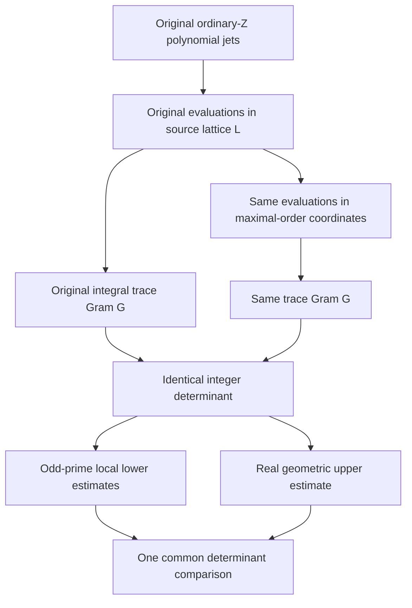

# Phase333 — classical maximal orders and the original jet lattice

> Two independent estimates, one unchanged integer determinant.

**Scope.** This note studies the exact inclusion of the original integer-pair
lattice into the maximal order of an imaginary quadratic field. It is not
an improved class-number-one or discriminant theorem. The earlier
[Phase331 exact-head verification](https://github.com/Dojo-1/tenth-discriminant/actions/runs/43902694177)
is separate; the [Phase332 sharper-radius workflow](https://github.com/Dojo-1/tenth-discriminant/actions/runs/43938261917)
also passed. Neither has been promoted to `main`.

## 1. The classical lattice and the source lattice

For squarefree `D > 0` with `D ≡ 3 (mod 4)`, let
`K = Q(√(-D))`, `ω = (1+√(-D))/2`. Then

```math
L=\mathbb Z[\sqrt{-D}]\subset
\mathcal O_K=\mathbb Z[\omega],\qquad
[\mathcal O_K:L]=2.
```

For the *same* element, coordinates change by

```math
x+y\sqrt{-D}=(x-y)+2y\omega,\qquad
T=\begin{pmatrix}1&-1\\0&2\end{pmatrix},\quad \det T=2.
```

The map is injective with image precisely those maximal-order coordinate
pairs whose second coordinate is even. Thus it is invertible after
localizing at any odd prime, but **not** over the integers at the prime 2.

The positive trace-pairing matrices are

```math
B_L=\begin{pmatrix}2&0\\0&2D\end{pmatrix},\quad
B_{\mathcal O_K}
=\begin{pmatrix}2&1\\1&(D+1)/2\end{pmatrix},
\qquad T^{\mathsf T}B_{\mathcal O_K}T=B_L.
```

In particular, `det B_L=4D` whereas `det B_{O_K}=D`.
These **rank-two coefficient trace matrices** are not the large
ordinary-jet Gram determinant in the original Tenth Discriminant method.

## 2. Local prime-power divisibility

Define coordinatewise divisibility of a pair `(x,y)` by an integer
`q`. For any odd `q`,

```math
(q\mid x\ \wedge\ q\mid y)
\quad\Longleftrightarrow\quad
(q\mid x-y\ \wedge\ q\mid2y).
```

This holds for all odd prime powers. The proof uses only the
identity `q = 2t+1` and Bézout cancellation, not ideal-theoretic
assumptions. It therefore applies to **each original ordinary-Z jet
value**, with samples and derivative directions unchanged.

The even-prime failure is not optional:

```math
1+\sqrt{-D}=2\omega\in2\mathcal O_K,
\qquad 1+\sqrt{-D}\notin2L.
```

The general safe implication is

```math
\alpha\in q\mathcal O_K\cap L
\quad\Longrightarrow\quad
2\alpha\in qL.
```

For `q=2^{k+1}`, the original-coordinate divisibility is therefore
limited by an explicitly visible power of two. Any improvement at 2
must be proved using the original jet lattice and an actual combined
row action; the index-two inclusion is not another determinant divisor.

## 3. The preserved production determinant

Use **exactly** the existing `integerDerivativeRow` and
`integerRectangularTraceGram` on the original integer-pair support
`Q`. Write each unchanged jet's coefficient pair in the maximal-order
basis; evaluate its positive trace pairing there. The result is an
**entrywise identical integer matrix**, hence an identical determinant.



No new nodes, derivatives, Gram, field discriminant, or sampled
maximal-order elements are introduced. The role of the maximal order
is **arithmetic interpretation of existing values**, not generating
an alternate observation operator.

## 4. Formal and computational artifacts

- [Lean source: `Phase333ClassicalLocalLattice.lean`](../../lean/TenthDiscriminant/Phase333ClassicalLocalLattice.lean)
- [Exact Python controls](test_classical_local_lattice.py)
- [Exact-head CI workflow](../../.github/workflows/phase333-classical-local-lattice.yml)

**P (classical mathematics):** the index-two coordinate inclusion,
odd-local equivalence, positive trace-pairing transport, and binary
counterexample admit elementary proofs.

**H (new encoded statements until CI passes):** the Lean module's
full same-source trace-Gram equality and divisibility theorems.

**M (once CI reports success):** the finite exact controls include
the non-real ordinary-jet samples and the negative binary witness.

**R (forbidden shortcut):** replacing `Q` by maximal-order samples,
counting the index-two correction as an extra 2-adic factor, multiplying
two independent determinant divisibility certificates, or promoting
a coordinate change to an improved discriminant bound.

## 5. Next implication to establish

A useful next theorem should connect classical inertness of odd primes
under the class-number-one hypothesis to a **strictly stronger local
filtration of the existing jet-evaluation module**. It must give an
actual additional valuation of the unchanged original Gram determinant.
A coordinate change alone cannot do so.

The complementary searches may carry informal workflow names
(Pandora Bee; Emperor–Empress), but the mathematical objects remain
ordinary: an integral lattice, localizations, evaluation maps,
filtrations, unimodular basis transformations, and Hadamard bounds.
