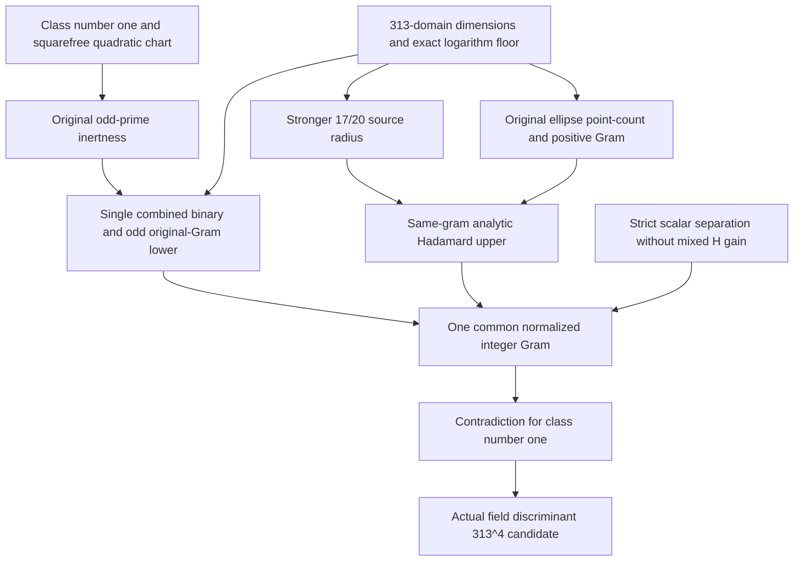

# 侘未来 · Phase336–338
## The two estimates meet on one original Gram

> No new mixed-binary valuation. No replacement sampling lattice.
> A stronger analytic saving, with every old field-theoretic hypothesis explicit.

**Status (17 November 2026):** Phase336 (real scalar), Phase337
(original Gram analytic upper), and Phase338 (arithmetic lower and
actual-field candidate) have been submitted to separate exact-head
Lean/CI workflows. They are **H / unverified** until their own
run conclusions and printed axioms are inspected. The prior checked
research-branch result remains the `315^4` field bound; public
`main` remains at `322^4`. Nothing in this protocol changes `main`.

## 1. The same source object in every comparison

Fix the existing original rectangle

```math
R=\lfloor D/4\rfloor,\qquad S=\lfloor R/25\rfloor,
\qquad\rho=\lceil(13/25)D^{3/4}\rceil,
\qquad\rho_{\mathrm{thin}}=\lceil(11/25)D^{3/4}\rceil.
```

Let `Qthin=ellipsePairs D (thinRadius D)`, original
`integerDerivativeRow`, W held constant in every ordinary Z
derivative, positive trace metric `(2,2D)`. Define **exactly**

```math
G_D=\mathrm{integerRectangularTraceGram}
(Q_{\mathrm{thin}},D,S,R,S),\qquad
s_D=R^2S.
```

The same `log(det G_D)/s_D` must occur in the new lower and upper.
The padded ellipse appears only in the **cardinality** majorant
for the existing Hadamard envelope; its determinant is never swapped
for `det G_D`.

## 2. Why the stronger radius matters

Classical cell-area counting and exact ceiling arithmetic supply
`Qthin` interpolation at D >= 313^4 (already checked in Phase332).
The stronger radius candidate is

```math
\rho_{\mathrm{thin}}\le\frac{17}{20}\rho
\quad(D\ge313^4).
```

The previously checked source-independent radius comparison then
gives normalized Hadamard savings of `27/200`, compared to the
previous `1/10`. The improvement is `7/200=0.035`.

**Arithmetic negative comparator:** with the old upper constant
and NO mixed H source gain, the conservative rational scalar
difference is `-0.004924564`; with the stronger radius, it becomes
`+0.030075436`. These are exact arithmetic evaluations of the
certified lower floors and upper rounding allowances, **not**
independent determinant estimates.

## 3. The intended theorem chain



On the odd class-number-one chart, the desired lower and upper are

```math
\begin{aligned}
\ell(D)&=0.999997\log D-5.7193+\tfrac14\log2
 +\left(\tfrac{4659}{625000}
 -\tfrac{16895455}{625000D}\right)\\
&\quad+
 \left(\tfrac{6931}{10^6}-\tfrac2R\right)
 +\left(\tfrac{873747}{250000000}-\tfrac{40}R\right),\\[4pt]
u(D)&=\tfrac45\log D-\tfrac{1923}{2000}.
\end{aligned}
```

**There is deliberately no extra `H(Z,W)=Z^2-W^2` term**.
The Phase332 mixed-binary conjecture remains an optional,
independently tested line, not a field-theorem dependency.

## 4. Formal source artifacts

- [Phase336 scalar / radius](../../lean/TenthDiscriminant/Phase336ScalarRadius313.lean):
  strict real inequality and 313-domain 17/20 contraction,
  [CI](../../.github/workflows/phase336-no-mixed-scalar.yml)
- [Phase337 dimensions](../../lean/TenthDiscriminant/Phase337Dimensions313.lean),
  [analytic scalars](../../lean/TenthDiscriminant/Phase337UpperScalars313.lean),
  and [original-Gram upper](../../lean/TenthDiscriminant/Phase337ThinUpper313.lean):
  [CI](../../.github/workflows/phase337-analytic313.yml)
- [Phase338 base arithmetic](../../lean/TenthDiscriminant/Phase338Lower313.lean),
  [joint arithmetic](../../lean/TenthDiscriminant/Phase338JointLower313.lean),
  and [field candidate](../../lean/TenthDiscriminant/Phase338Field313Candidate.lean):
  [CI](../../.github/workflows/phase338-field313.yml)
- [Exact rational controls and the older-bound negative](../phase336/test_scalar_no_mixed_313.py)

## 5. Non-negotiable stop rules

1. A `313^4` theorem cannot call a `315^4` premise for the same D,
   even if a structurally similar theorem compiled yesterday.
2. Only the **same original integer Gram** can enter both inequalities.
   Replacing its source by the maximal order, a padded Q determinant,
   Hasse-only derivatives, or a different metric invalidates the chain.
3. No independent binary valuation may be multiplied into the
   combined row action without proving joint unimodularity.
4. A positive scalar margin is **necessary, not sufficient**.
   Without separately verified lower and upper at 313, the field
   theorem remains H.
5. Preserve unsuccessful Lean/CI runs and rejected source
   interpretations in a failure ledger. Do not edit thresholds just
   to make a failing proof compile.
6. Successful exact-head Lean verification is P **relative to the
   encoded source and usual logical axioms**, not human-independent
   validation of the mathematical model, originality or publication.

## 6. Independent mathematical review

An adversarial check should reconstruct one `Qthin` Gram from the
definitions, verify the analytic/count bounds without trusting
commentary, inspect the class-number-one/inert-prime transport,
trace the joint binary determinant action, and independently prove
that the final logarithmic source lower and upper refer to the
same positive integer determinant.

The next release decision is separate from CI: no `main` merge
without source-meaning review.
